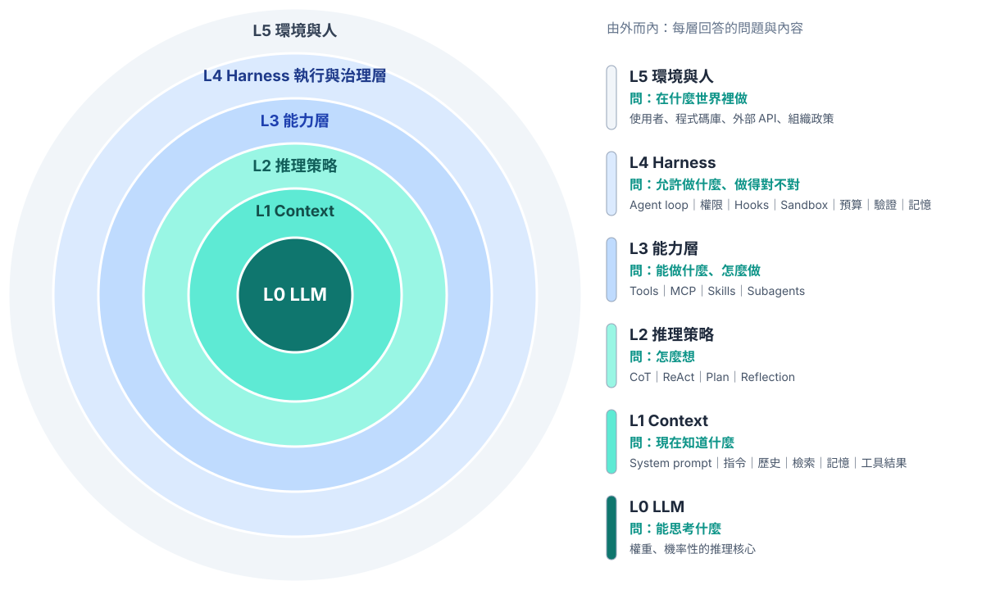
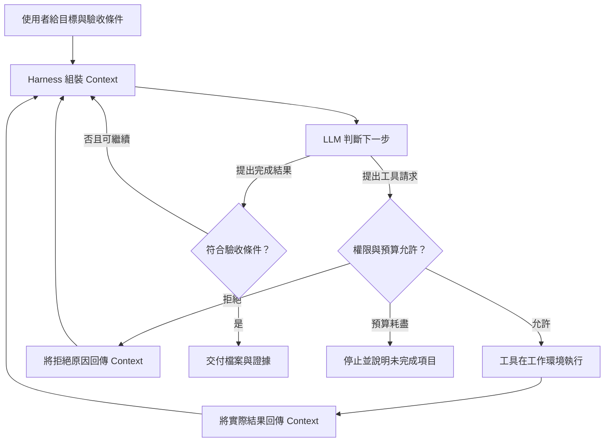
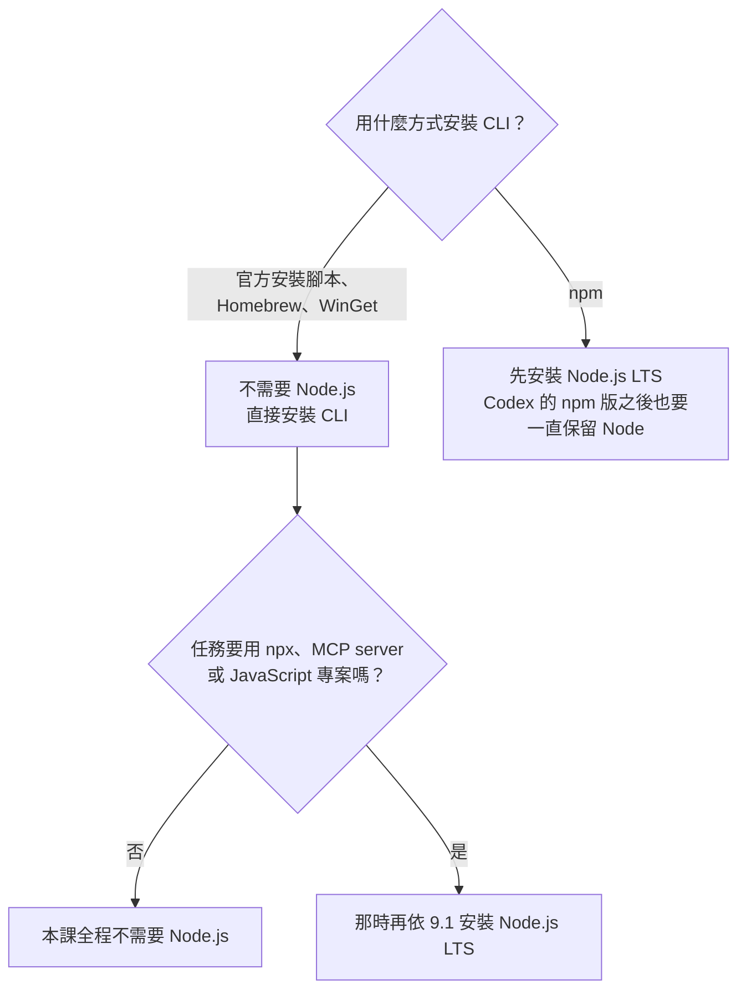
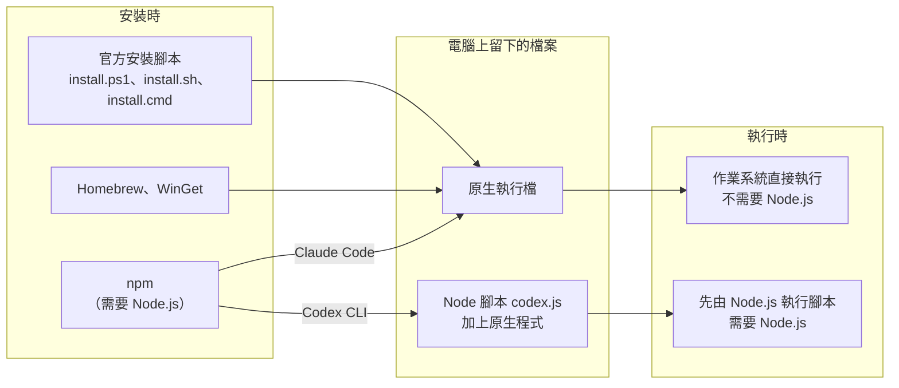
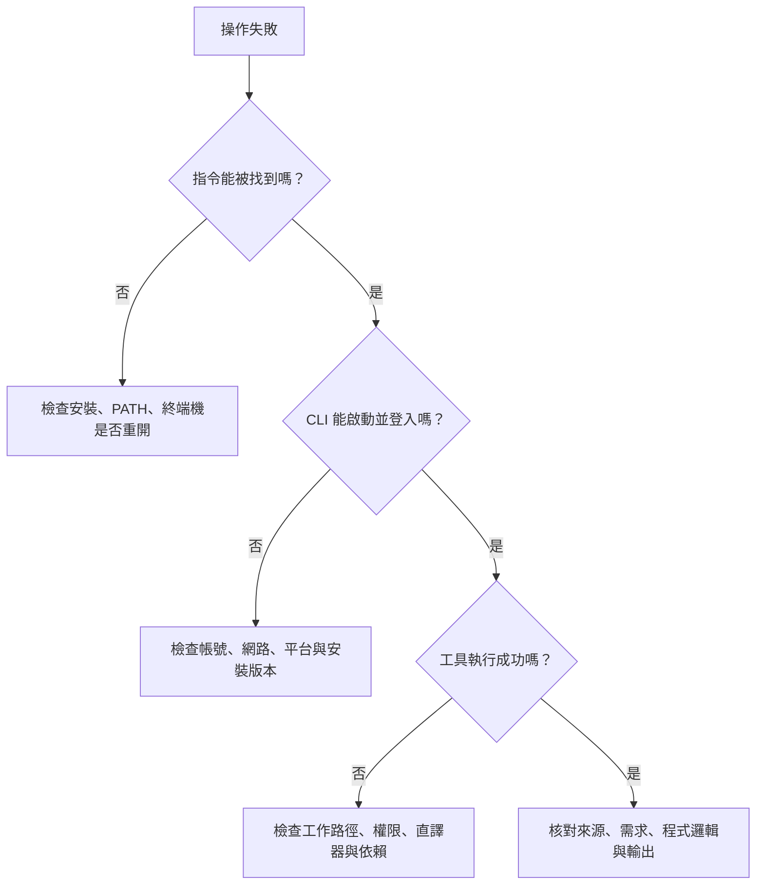

<!-- Path: AI_Agent_CLi | Updated: 2026-10-31 | Version: b05-course-revision -->
# 前導章：讓 AI Agent 成為個人工作與學習助理

**Codex CLI／Claude Code 雙主線｜環境建置與實作教材**

> 對象：具備基本電腦操作能力的高中生、教師與初學者。  
> 主線：Windows 11 ＋ PowerShell 7 ＋ VS Code；另附 macOS 操作差異。  
> 建議時數：6 節課，每節 50 分鐘；安裝與帳號準備可課前完成。  
> 本課程版官方文件查核日期：2026-10-31。Codex CLI 與 Claude Code 為必選其一的主線；Antigravity 為選讀比較。原 b05 的套件盤點與測試屬 2026-10-29 歷史紀錄，並非本次重新執行。工具版本會更新，授課前請重新確認官方需求。  
> 來源：使用者提供的完整 `00_intro.md`。原始大綱 `AI_working_env.md` 未隨本課程提供，故不建立失效連結；本課保留完整章節與練習。

## 0. 使用方式與學習目標

本教材從「模型為什麼需要工作環境」開始，帶你安裝工具、建立專案、交付 AI 任務，再以 Python 自動整理學習紀錄。完成後，你應能獨立建立一個可追蹤變更、可重現執行結果的個人助理專案。

### 0.1 完成後能做到什麼

1. 用 L0–L5 六層架構說明 LLM、Context、Tools 與 Harness 的關係。
2. 分辨安裝 CLI 所需環境、CLI 本身的執行依賴，以及工作專案的依賴。
3. 在正確資料夾啟動 AI Agent，讓它依資料與規則產生可檢查的文件。
4. 使用 Git 記錄修改，辨識未追蹤、未暫存與已暫存的變更。
5. 透過 `uv` 管理 Python 版本、虛擬環境與套件，並在 VS Code 選對直譯器。
6. 依據實際輸出與測試證據驗收 AI 工作，而不是只看它的完成宣告。

### 0.2 課程安排與交付物

| 節次 | 主題 | 學習者交付物 |
|---|---|---|
| 1 | Agent 分層、Workflow、工具角色 | 六層對照表與一個任務分析 |
| 2 | 安裝 VS Code、PowerShell、Git、CLI | 版本與安裝方式紀錄 |
| 3 | 專案資料夾與 Git | 第一次 commit、README 與忽略規則 |
| 4 | 專案指引與 AI 文件整理 | AGENTS.md、有來源的學習重點 |
| 5 | Python、uv、VS Code 執行與除錯 | 可執行的學習時間統計程式 |
| 6 | 驗證、故障排查與綜合任務 | 執行紀錄、修正說明、版本紀錄 |

**閱讀路線：**只想整理筆記，先完成第 1–7 章與第 10–12 章；想加入程式自動化，再完成第 8–9 章。主線只需從 Codex CLI 或 Claude Code 選一種，不需要全部安裝。Antigravity 的安裝、遷移與盤點是選讀內容，不列入六單元必做項目。

### 0.3 指令閱讀約定

- 標成 `powershell` 的區塊在 PowerShell 執行；標成 `bash` 的區塊在 macOS Terminal 的 zsh／bash 執行。
- `transcript` 是輸入給 AI 的提示或預期輸出，不能當成終端機指令執行。
- 每次只執行一小段，確認結果後再往下做；不要把整份講義一次貼入終端機。
- 本教材使用 `%USERPROFILE%` 對應的個人目錄；PowerShell 的寫法是 `$env:USERPROFILE`。macOS 使用 `$HOME`。
- 範例的姓名、郵件、版本輸出都是示意；請改成自己的值。登入憑證只在官方登入頁或指定設定位置輸入。

## 1. 為什麼需要一個 AI 工作環境（Why）

### 1.1 從問答到完成任務

在純文字問答中，你把資料貼給模型，模型回覆文字，再由你複製、修改與存檔。當資料分散在十幾個檔案，反覆貼上會造成遺漏，也難以知道內容修改了哪些地方。

Agent 工作方式加入了工具與回饋：系統讀取指定檔案，讓模型判斷下一步，透過工具建立內容，再用實際檔案或程式結果檢查。你仍需要提供目標與驗收條件，但不用手動搬運每一段資料。

| 工作模式 | 人主要做什麼 | 系統主要做什麼 | 本課例子 |
|---|---|---|---|
| 單次問答 | 提供文字、整理結果 | 回答問題 | 解釋什麼是虛擬環境 |
| 工具輔助問答 | 指定資料與可用工具 | 搜尋或讀檔後回答 | 閱讀指定筆記並摘要 |
| 固定 Workflow | 設計步驟、檢查輸出 | 依既定步驟處理 | CSV → 統計 → 報表 |
| Agent 迴圈 | 訂目標與邊界、驗收 | 依中間結果決定下一步 | 找出統計錯誤、修正並重跑 |

這是理解工作方式的教學順序，不表示所有產品都依此順序演進，也不表示 Agent 一定比固定流程好。

### 1.2 環境建置解決的四個問題

**資料在哪裡？**用專案資料夾集中來源、程式、結果與規則。

**如何執行？**用 shell 啟動工具，讓 Python 或 Node.js 執行需要的程式。

**修改了什麼？**用 Git 檢查差異與建立可追蹤的版本。

**如何確認正確？**先寫出可核對的預期結果，再用測試、來源比對與人工閱讀驗收。

## 2. LLM 與 Agent 的六層關係（What）

### 2.1 引用的分層圖



*圖 1：引用 Joel 的 [AI Agent 分層模型](https://joelhoty.github.io/onclassbyJoel/AI/ai_agent_harness_workflow.html) 第 1.2 節（原文更新 2026-10-16）。本地 SVG 保留原圖內容與布局，補白色背景以適應深色閱讀介面。文字來源：[Markdown 原文](https://joelhoty.github.io/onclassbyJoel/AI/ai_agent_harness_workflow.md)。*

**讀圖提醒：**這是一個教學用的概念分層，不是產業通用的六層標準，也不是六個必須依序安裝的軟體。圓圈表示關注範圍，並不表示工具必須存在模型內部，或每次請求都由 L0 依序走到 L5。實際執行時，各層會互相配合。

### 2.2 各層如何對應本課任務

以「讀取學習筆記，產生重點與自我測驗」為例：

| 層級 | 核心問題 | 在本課中的具體角色 | 發生問題時先檢查 |
|---|---|---|---|
| L0：LLM | 模型能理解與產生什麼？ | 理解筆記、生成摘要與題目 | 是否誤解概念或憑空補充 |
| L1：Context | 本次模型實際看到了什麼？ | 使用者任務、指引、已讀筆記、工具結果 | 是否漏讀檔案、資料過期或被截斷 |
| L2：推理策略 | 如何拆解與檢查任務？ | 先列重點，再寫題目，最後核對答案 | 是否缺少規劃或核對步驟 |
| L3：能力 | 能採取哪些動作？ | 讀檔、寫檔、搜尋、執行 Python | 工具是否可用、路徑是否正確 |
| L4：Harness | 如何執行、設限與取得回饋？ | 管理迴圈、權限、context、日誌與驗證 | 權限是否阻擋、執行失敗是否回報 |
| L5：環境與人 | 任務在什麼條件下發生？ | 學生、教師、作業要求、電腦與檔案 | 目標、期限、帳號或網路是否有問題 |

這些分類沿用原文的架構；表中的學習情境與排查方法是本教材的延伸設計。

### 2.3 模型、CLI 與執行環境有何不同

LLM 接收 context，產生文字或結構化工具請求。它不會因為知道一個檔案路徑，就自動取得該檔案；必須由宿主系統提供讀檔能力並回傳內容。

Agent CLI 是你操作整套系統的入口，通常整合或連接模型、context 管理與工具執行機制。**CLI 是產品介面與程式；LLM 是其中使用的模型；Harness 是支撐任務迴圈的執行與控制機制。**同一個 CLI 可隨版本或帳號提供不同模型；相同模型放進不同環境，也可能得到不同結果。

教材採用以下概念公式，幫助檢查是否漏了某個環節：

> Agent 系統 ≈ 模型 ＋ 情境資料 ＋ 可用能力 ＋ 執行限制 ＋ 回饋迴圈。

這不是可代入數值的數學公式，也不是每個產品的實作規格。

### 2.4 Prompt、Context、Tools、Skills 與 MCP

| 名稱 | 用途 | 初學者例子 | 不應混淆的地方 |
|---|---|---|---|
| Prompt | 描述要求與任務 | 「整理為五個重點」 | 是 context 的一部分 |
| Context | 本次推論可用的資訊 | 指令、歷史、筆記與讀檔結果 | 硬碟上存在，不等於模型已讀取 |
| Tool | 執行具體動作 | 讀取檔案、執行命令 | 工具說明不等於工具執行結果 |
| Skill | 可重用的工作方法與資源 | 摘要時先辨識主張，再核對證據 | 不會自行增加系統權限 |
| MCP | 連接工具與資料來源的協定 | 透過 MCP 連接筆記服務 | 不是另一個 LLM，也不保證資料正確 |
| Subagent | 分派工作並維持較獨立的 context | 一個檢查程式、一個整理說明 | 更多 agent 不必然更準或更省成本 |

推理策略可以包含規劃、行動後觀察與自我檢查。課堂上應要求 AI 說明**簡潔的計畫、可驗證依據及結果**，不需要要求它揭露隱藏的內部思考過程。模型自我檢查仍可能犯錯，需配合外部證據。

### 2.5 軟限制與硬限制

把「不要改原始檔」寫在 AGENTS.md，是給模型的行為指引。把來源資料夾設成唯讀，則是由執行環境拒絕寫入。兩者可搭配使用。

| 規則或機制 | 類型 | 效果與邊界 |
|---|---|---|
| 「使用繁體中文」 | 軟限制 | 引導輸出風格，仍需校對 |
| 「只根據來源摘要」 | 軟限制 | 引導使用證據，仍可能漏引或誤引 |
| 「先執行測試」 | 軟限制 | 規範流程，需查看測試紀錄 |
| 檔案系統拒絕寫入指定路徑 | 硬限制 | 在正確實施的權限範圍內阻擋寫入 |
| 實際啟用的 sandbox、網路限制 | 硬限制 | 依隔離機制限制操作範圍 |
| 程式實施的次數上限、輸出格式檢查 | 硬限制 | 超限停止或拒收不符格式的結果 |

**硬限制不是「絕對不會出事」的保證。**它依賴權限配置、工具實作與涵蓋範圍；Hooks 也只有在會攔截並拒絕操作時，才構成相應的強制控制。記錄日誌的 Hook 不等於阻擋操作。驗證格式通過，也不代表內容事實正確。

### 2.6 Agent 迴圈：圖中的各層如何合作



圖中是概念設計，並非宣稱每一款 CLI 都會自動做相同的驗收。實務上可能需要使用者明確要求測試，或在工作流程中另設檢查步驟。

### 2.7 Workflow 與 Agent：誰決定下一步

固定流程可以包含 LLM；Agent 也可以執行固定步驟。判斷重點是「下一步主要由預先定義的規則決定，還是由模型依目前結果選擇」。這個區分可參考 Anthropic 的 [Building effective agents](https://www.anthropic.com/research/building-effective-agents)。

| 情境 | 建議方式 | 理由 |
|---|---|---|
| 每週將相同欄位的 CSV 加總 | 固定程式或 Workflow | 規則明確，容易測試 |
| 不知道為何報表少算一筆 | Agent 協助診斷 | 需根據中間結果選擇檢查方式 |
| 整理不同格式的閱讀筆記 | Agent 加明確驗收條件 | 需理解內容與結構 |
| 自動發布班級公告 | 固定發布流程內嵌草稿生成 | 草稿生成與正式發布分開驗收 |

不要把「多代理」直接理解為更高自主性；多個代理也可能由固定流程逐一呼叫。成本與延遲取決於呼叫次數、資料量、工具與模型，不能只看名稱判斷。

**課堂小練習：**AI 說找不到 `notes.md`，可能是 L0 的模型能力問題嗎？先檢查 L1 是否提供檔案、L3 讀檔工具是否成功、L5 的檔名與路徑是否正確，再考慮模型理解能力。

## 3. 工具地圖與安裝需求

### 3.1 每個工具負責什麼

| 工具 | 主要角色 | 本課何時需要 |
|---|---|---|
| VS Code | 編輯文件與程式，整合終端機與版本差異 | 基礎操作 |
| PowerShell | 解讀並執行命令的 shell | Windows 主線 |
| Windows Terminal | 容納不同 shell 的終端機介面 | 可選；VS Code 終端機也能操作 |
| Git | 追蹤專案檔案變更 | 基礎操作 |
| Agent CLI | 透過終端機使用 Agent 系統 | 選一款安裝 |
| Node.js | JavaScript 執行環境，通常附 npm | npm 安裝路線、部分 MCP 或 JS 專案 |
| Python | 執行 Python 程式 | 第 8 章開始 |
| uv | 管理 Python、依賴與專案環境 | Python 主線 |

**VS Code 擴充功能不等於編譯器或直譯器。**例如 Python 擴充功能協助選擇環境、執行與除錯，但 Python 程式仍需要 Python 直譯器。C/C++、Java、Go、Rust 等也各有工具鏈；安裝擴充功能不代表工具鏈已裝妥。[VS Code Python 官方教學](https://code.visualstudio.com/docs/python/python-tutorial)

### 3.2 CLI 還需要 Node.js 嗎？

**要不要先裝 Node.js，取決於你用什麼方式安裝 CLI。**先從 Codex CLI 或 Claude Code 選一款，再選安裝方式。以下保留 Antigravity 比較欄，供已有 Google 工具的教師選讀。

#### 3.2.1 四種安裝方式比較

**基本資料（原稿套件盤點日 2026-10-29；2026-10-31 複核官方安裝文件）：**

| 安裝方式 | 適用平台 | 三款 CLI 官方是否提供 | 安裝時需要 Node.js？ | 執行時需要 Node.js？ | 更新方式 |
|---|---|---|---|---|---|
| 官方安裝腳本（原生版） | Windows、macOS、Linux | Claude Code、Codex、agy 都有；本課選原生腳本為主要路線 | 否 | 否 | Claude Code、agy 在背景自動更新；Codex 重跑安裝指令或 `codex update` |
| Homebrew cask | macOS、Linux（依各 cask 平台清單） | Claude Code、Codex、agy 都有 cask | 否 | 否 | 手動 `brew upgrade`（agy 的 cask 標示會自行更新） |
| WinGet | Windows | 只有 Claude Code（`Anthropic.ClaudeCode`）；Codex 官方頁未列 CLI 的 WinGet，agy 官方未列 | 否 | 否 | 手動 `winget upgrade` |
| npm | 有 Node.js 的任何平台 | Claude Code、Codex 有；agy 未提供 | **是**（Claude Code 要 22+） | Claude Code：否；Codex：**是** | 手動 `npm install -g <套件>` |

**優缺點：**

| 安裝方式 | 優點 | 缺點 |
|---|---|---|
| 官方安裝腳本 | 本課採用原生安裝；不需 Node.js、不需系統管理員權限；Claude Code 與 agy 會自動更新；三款 CLI 在三種作業系統都能用 | 要執行從網路下載的腳本（`irm ... \| iex`、`curl ... \| sh`），學校電腦可能被資安政策或 PowerShell 執行原則擋下；三款 CLI 的更新方式不一致 |
| Homebrew | 一個工具統一安裝、更新、移除多套軟體；不需 Node.js；由 Homebrew 驗證下載檔 | 要先裝 Homebrew，並依 cask 的支援平台選用；Claude Code cask 不會自動更新，`claude-code` 跟隨 stable 頻道，約晚一週；和官方腳本各裝一份時容易混淆 |
| WinGet | Windows 10／11 內建；學校 IT 可統一派送；不需 Node.js | 三款中只有 Claude Code 有官方套件；不會自動更新；Claude Code 執行中升級可能因檔案被鎖住而失敗 |
| npm | 已有 Node 開發環境的人熟悉；各平台指令相同；可用 `@版本號` 固定版本 | 必須先裝 Node.js；Codex 的 npm 版每次執行都要 Node，換 Node 版本或用 nvm 切換後指令可能消失；全域安裝常遇到權限問題（不可用 `sudo npm`）；Windows 可能卡在 `npm.ps1` 執行原則；官方可用的替代方式，依實際需求選用 |

本表的 Homebrew 平台與執行檔資訊可在 [Codex cask](https://formulae.brew.sh/cask/codex)、[Claude Code cask](https://formulae.brew.sh/cask/claude-code)、[Antigravity CLI cask](https://formulae.brew.sh/cask/antigravity-cli) 逐一確認；本課 macOS 路線示範 Homebrew，Linux 可依官方腳本或支援套件選用。

#### 3.2.2 建議與結論

| 使用者情境 | 建議的安裝方式 | 理由 |
|---|---|---|
| 學生、初學者（本課主線） | **官方安裝腳本** | 不需 Node；Codex 與 Claude 的安裝步驟短，但更新方式不同 |
| macOS 且平常就用 Homebrew 管理軟體 | Homebrew cask | 統一管理；記得定期 `brew upgrade` |
| 學校 IT 統一派送的 Windows 電腦 | Claude Code 用 WinGet；Codex 用官方部署文件的固定版本安裝腳本（5.3）；agy 用官方腳本 | 可控制版本並集中管理 |
| 已有 Node 開發環境的進階使用者 | 仍建議官方安裝腳本；npm 只在需要固定版本時使用 | 避免 Codex 綁定 Node、避免與原生版重複安裝 |

> **結論：本課建議用官方安裝腳本安裝 CLI，因此不需要先裝好 Node.js。**  
> 安裝時不需要，之後每次執行也不需要。只有兩種情況才要裝：一是你改用 npm 安裝 CLI，二是 AI 的任務本身用到 Node（例如用 `npx` 啟動 MCP server、處理 JavaScript 專案）。Node.js 是選修項目，等真的需要時再依第 9.1 節安裝 LTS 版。

| 你的情況 | 要先裝 Node.js 嗎？ | 說明 |
|---|---|---|
| 依本課用官方安裝腳本安裝三款 CLI 任一款 | **不用** | 安裝腳本由系統內建的 PowerShell／bash 執行，裝好的是原生執行檔 |
| 改用 Homebrew 或 WinGet 安裝 | **不用** | 套件管理器下載的是同一份原生執行檔 |
| 改用 npm 安裝 Claude Code | **要**，Node.js 22+ | 只有安裝時需要；裝好的 `claude` 執行時不呼叫 Node。仍建議改用官方安裝腳本 |
| 改用 npm 安裝 Codex CLI | **要**，而且之後不能移除 | `codex` 每次都由 Node 啟動；移除或切換 Node 版本就無法執行。建議改用官方安裝腳本 |
| AI 的任務要用 `npx` 啟動 MCP server，或處理 JavaScript 專案 | **要**，到時再裝 | 這是任務需要，與 CLI 怎麼安裝無關；依第 9.1 節安裝 LTS 版 |
| 電腦原本就裝有 Node.js | 不用移除 | 不影響原生版 CLI；但同一台電腦只保留一種 Node 管理方式（見 9.1） |



3.2.3 以後說明這個結論的根據：先把「原生版」「standalone」「npm 版」「安裝時」「執行時」這幾個詞講清楚，再逐一對照。

#### 3.2.3 先分清楚四種檔案與工具

| 名詞 | 是什麼 | 怎麼被執行 | 例子 |
|---|---|---|---|
| 原生執行檔（native binary） | 已經編譯成作業系統與 CPU 能直接執行的機器碼檔案 | 作業系統直接載入，**不需要**另外安裝直譯器 | Windows 的 `claude.exe`；macOS 的 `codex`（Mach-O 格式） |
| 腳本（script） | 純文字的程式碼檔 | 必須由對應的直譯器讀取後執行：`.js` 要 Node.js，`.ps1` 要 PowerShell，`.sh` 要 bash | npm 版 Codex 的 `codex.js`；安裝用的 `install.ps1` |
| 安裝腳本（installer） | 負責「下載 → 檢查 → 放到指定資料夾 → 加入 PATH」的腳本，做完就結束 | 由作業系統內建的 shell 執行（PowerShell、CMD、bash、zsh） | `https://claude.ai/install.ps1`、`https://chatgpt.com/codex/install.sh` |
| 套件管理器（package manager） | 統一負責下載、更新、移除軟體的工具 | 它本身也是程式，各有自己的需求 | npm（**本身要 Node.js**）、Homebrew、WinGet |

**重點：安裝腳本不等於 CLI 本身。**`install.ps1` 雖然是腳本，但由 Windows 內建的 PowerShell 執行，所以不需要 Node；它執行完會在電腦上留下一個原生執行檔，之後每次輸入 `claude` 跑的是那個執行檔，跟安裝腳本已經無關。

#### 3.2.4 「原生版」「standalone」「npm 版」指的是什麼

這三個詞描述的角度不同：「原生」說的是**最後執行的是什麼檔案**，「standalone」說的是**用什麼管道安裝**。

| 本教材用語 | 定義 | 官方文件的稱呼 | 安裝後電腦上留下什麼 |
|---|---|---|---|
| 原生版 | 執行官方網站提供的安裝腳本，取得原生執行檔，放進使用者目錄並加入 PATH | Claude Code：Native Install；Codex：standalone installer；Antigravity：native build 安裝腳本 | 原生執行檔，例如 `~/.local/bin/claude`、`%LOCALAPPDATA%\Programs\OpenAI\Codex\bin\codex.exe` |
| standalone 版 | Codex 官方對「原生版」的稱呼。意思是「獨立安裝」：不經過 npm 等套件管理器，也不依賴其他執行環境 | Codex：standalone | 同上，原生執行檔 |
| Homebrew／WinGet 版 | 由套件管理器下載**同一份**原生執行檔 | 各家列為替代安裝方式 | 原生執行檔，位置由套件管理器管理（例如 `/opt/homebrew/bin/`） |
| npm 版 | 用 `npm install -g <套件>` 安裝 | 各家列為替代安裝方式 | **依工具不同**：Claude Code 是原生執行檔；Codex 是 Node 腳本 `codex.js` 加上原生程式 |

所以在本教材中，「Codex standalone 版」和「Codex 原生版」指的是同一件事；Homebrew 版也是原生執行檔，但它透過套件管理器安裝，不算 standalone。

#### 3.2.5 安裝時、執行時、任務時：三個時間點各需要什麼

| 時間點 | 問的問題 | 由什麼決定 | 例子 |
|---|---|---|---|
| 安裝時 | 把 CLI 放到電腦上的**那一次**，需要什麼工具？ | 選用的安裝方式 | 官方安裝腳本只要系統內建的 shell；npm 安裝要先有 Node.js |
| 執行時 | **每次**輸入 `claude`、`codex`、`agy` 啟動時，作業系統實際載入什麼？ | 安裝後留下的是原生執行檔還是 Node 腳本 | 原生執行檔直接啟動；Node 腳本要先啟動 Node |
| 任務時 | CLI 已經在跑，AI 要做的**工作**還需要什麼？ | 任務內容，跟 CLI 怎麼安裝無關 | 用 `npx` 啟動 MCP server、執行 JavaScript 專案的 `npm test`，都要 Node |



#### 3.2.6 三款 CLI 逐一對照

| 工具與安裝方式 | 安裝時需要 | 安裝後留下的檔案 | 執行時需要 Node.js？ | 本課選擇 |
|---|---|---|---|---|
| Claude Code 原生版（官方安裝腳本） | 系統內建 shell | 原生執行檔 `claude`（Windows：`claude.exe`） | 否 | **採用** |
| Claude Code Homebrew cask／WinGet | Homebrew 或 WinGet | 同一份原生執行檔 | 否 | 可替代；預設不自動更新 |
| Claude Code npm 版 | **Node.js 22+** 與 npm | npm 依平台下載同一份原生執行檔（套件入口為 `bin/claude.exe`） | 否 | 不建議：要先裝 Node，且容易和原生版重複安裝 |
| Codex standalone 版（官方安裝腳本） | 系統內建 shell | 原生執行檔 `codex`（Rust 編譯） | 否 | **採用** |
| Codex Homebrew cask | Homebrew | 同一份原生執行檔 | 否 | 可替代 |
| Codex npm 版 | **Node.js**（套件宣告 `node >= 16`）與 npm | 套件入口 `bin/codex.js` 是 Node 腳本，再由它呼叫原生程式 | **是** | 不建議：移除或切換 Node 版本後，`codex` 就無法啟動 |
| Antigravity CLI 原生版（官方安裝腳本） | 系統內建 shell | 原生執行檔 `agy` | 否 | **選讀，不是課程必裝** |
| Antigravity CLI Homebrew cask | Homebrew | 原生執行檔 `agy` | 否 | 可替代 |

查核方式與來源：官方安裝頁——[Claude Code Setup](https://code.claude.com/docs/en/setup)、[Codex CLI](https://learn.chatgpt.com/docs/codex/cli)、[Codex GitHub README](https://github.com/openai/codex)、[Codex Windows 部署](https://learn.chatgpt.com/docs/enterprise/windows-deployment)、[Antigravity CLI 安裝](https://antigravity.google/docs/getting-started?tab=cli)。npm 版「執行時是否需要 Node」以 `npm view <套件> engines bin` 查看：`engines` 是套件宣告的 Node 版本，`bin` 是輸入指令時實際執行的入口檔。入口是 `.js` 就由 Node 執行；入口是 `.exe` 或原生檔就不需要 Node。Homebrew cask 以 `brew info --cask <名稱>` 確認安裝內容為原生執行檔（Binary）。

**自己動手確認（macOS）：**

```bash
file "$(realpath "$(command -v codex)")"
```

輸出含 `Mach-O ... executable` 代表原生執行檔；輸出含 `script text` 且第一行是 `#!/usr/bin/env node`，代表是要靠 Node 執行的腳本。Windows 與更完整的盤點方式見第 5.8 節。

早期教學常以 npm 為主要入口，所以常先安裝 Node.js；這不表示所有 CLI 的歷史版本都採同一架構。本課不指定每款工具「從哪個版本開始改成原生」，以免把未查核的版本分界寫成事實。

#### 3.2.7 CLI 改用 Rust 撰寫，就不需要 Node.js 了嗎？

決定因素是「發行方式」，不是「撰寫語言」。

| 工具 | 原生執行檔的實作（查核方式） | 原生版需要 Node？ | 仍可能需要 Node 的情況 |
|---|---|---|---|
| Codex CLI | Rust 編譯的原生程式（官方 repo 的 `codex-rs`；執行檔內含 `rustc` 編譯資訊） | 否 | 改用 npm 版時，`codex.js` 啟動腳本要靠 Node 執行 |
| Claude Code | 不是 Rust；是把 JavaScript 與 Bun runtime 打包成單一執行檔（執行檔內含 `Bun v1.x` 標記） | 否；runtime 已內建，不呼叫系統 Node | npm 只用來下載；安裝時要求 Node 22+ |
| Antigravity CLI | 官方稱「native build」，未公開實作語言 | 否 | 官方路線未列 Node 需求 |

所以「Rust 寫的 → 不用 Node」只說對一半：

1. **原生執行檔**（不論 Rust、Go，或把 JS runtime 一起打包）啟動時都不需要系統裝 Node。
2. **同一工具的 npm 版**可能仍用 Node 腳本當入口，Codex 就是例子。
3. **任務依賴**與 CLI 語言無關：MCP server 常用 `npx` 啟動、JavaScript 專案要跑 `npm test`，這些仍需要 Node。

#### 3.2.8 官方安裝指令一覽

依 3.2.2 的結論，三款 CLI 都用下表的官方安裝腳本安裝，就不需要先裝 Node.js；Google 路線仍為選讀。

**雙主線與選讀工具的安裝方式一覽（官方文件複核日 2026-10-31）：**

| 工具（指令） | 官方推薦 | Windows PowerShell | Windows CMD | macOS／Linux | 套件管理器 | 自動更新 |
|---|---|---|---|---|---|---|
| Claude Code（`claude`） | 原生版（官方稱 Native Install） | `irm https://claude.ai/install.ps1 \| iex` | `curl -fsSL https://claude.ai/install.cmd -o install.cmd && install.cmd && del install.cmd` | `curl -fsSL https://claude.ai/install.sh \| bash` | WinGet `Anthropic.ClaudeCode`；Homebrew `claude-code`（stable）或 `claude-code@latest` | 原生版會在背景自動更新；WinGet／Homebrew 預設不會 |
| Codex CLI（`codex`） | 原生版（官方稱 standalone） | `powershell -ExecutionPolicy ByPass -c "irm https://chatgpt.com/codex/install.ps1 \| iex"` | 官方未提供；開新的 PowerShell 視窗執行 | `curl -fsSL https://chatgpt.com/codex/install.sh \| sh` | Homebrew `brew install --cask codex`；npm `npm install -g @openai/codex` | 官方更新方式：重跑安裝指令（支援 self-update 的發行版可用 `codex update`） |
| Antigravity CLI（`agy`） | 原生版（官方安裝腳本） | `irm https://antigravity.google/cli/install.ps1 \| iex` | `curl -fsSL https://antigravity.google/cli/install.cmd -o install.cmd && install.cmd && del install.cmd` | `curl -fsSL https://antigravity.google/cli/install.sh \| bash` | Homebrew `brew install --cask antigravity-cli`（需 macOS 12+） | 執行時在背景自動更新 |

若在 Markdown 原始碼中看到表格內的 `\|`，那是表格的跳脫寫法；實際輸入終端機時只打 `|`。複製指令時以第 5 章程式碼區塊為準。

### 3.3 選讀比較：Antigravity CLI（agy）

Google 的 Agent CLI 已由 Gemini CLI（`gemini`）改為 Antigravity CLI（`agy`），本教材的 Google 路線只使用 `agy`。`agy` 是原生 binary，不需要 Node.js。原本為 Gemini CLI 寫的 `GEMINI.md` 在 `agy` 中仍會生效；電腦上還留有舊 `gemini` 指令的人，依第 5.5 節遷移後移除。[官方遷移說明](https://antigravity.google/docs/cli/gcli-migration)

### 3.4 作業系統、帳號與資源

| 項目 | 本課做法 | 說明 |
|---|---|---|
| Windows | Windows 11、PowerShell 7、原生 CLI | 避免第一堂課同時混用 WSL 與 Windows 工具 |
| macOS | 使用仍受工具支援的 macOS 與 zsh | Apple Silicon／Intel 需選對安裝包 |
| 記憶體 | 課堂建議 8 GB 以上，16 GB 較充裕 | 是同時開編輯器、瀏覽器與 CLI 的教學建議，不是所有工具官方最低需求 |
| 網路 | 能連線官方下載與登入服務 | 安裝成功不代表學校網路允許模型連線 |
| 帳號 | 選用 CLI 對應的可用帳號或 API 配置 | 授權、地區、組織政策與額度以登入畫面及官方文件為準 |
| GPU | 本課不要求獨立 GPU | 本課使用雲端模型服務，不安排本機大型模型推論 |

| CLI | 官方列出的系統條件 |
|---|---|
| Claude Code | macOS 13.0+；Windows 10 1809+ 或 Windows Server 2019+；Ubuntu 20.04+、Debian 10+、Alpine 3.19+；4 GB+ RAM；x64 或 ARM64 |
| Codex CLI | 安裝腳本支援 macOS（Apple Silicon、Intel）、Linux（x86_64、arm64）與原生 Windows；官方未另列記憶體門檻 |
| Antigravity CLI | 安裝腳本支援 64 位元 Windows、macOS、Linux；Homebrew cask 標示 macOS 12+；官方未另列 CLI 專用的記憶體門檻 |

Antigravity 的 App、CLI、IDE、SDK 是不同介面，不把 App 的最低 OS 或 SDK 的 Python 需求直接套到 CLI。[Claude Code 需求](https://code.claude.com/docs/en/setup)、[Codex GitHub README](https://github.com/openai/codex)、[Antigravity 各介面](https://antigravity.google/docs/getting-started?tab=cli)

授課前先在一台與教室相同的電腦測試登入與基本任務。課堂不需要同時購買多家服務；使用可用的一種即可。

## 4. Windows 基礎環境安裝（How）

### 4.1 安裝順序


### 4.2 安裝 VS Code

1. 開啟 [VS Code Windows 官方安裝說明](https://code.visualstudio.com/docs/setup/windows)，下載適合電腦架構的安裝程式。
2. 一般個人電腦可選 User Setup；依精靈完成安裝，確認加入 PATH 的選項。
3. 啟動 VS Code，熟悉左側檔案總管、中央編輯區、Extensions 與 Source Control。
4. 開啟命令選擇區 `Ctrl+Shift+P`，搜尋 `Terminal: Create New Terminal`。
5. 若剛完成安裝，重新開啟終端機後確認：

```powershell
code --version
```

**成功判準：**印出版本資訊。若找不到 `code`，仍可從開始功能表開啟 VS Code，用「File → Open Folder」開啟專案，稍後再處理 PATH。

Markdown 預覽可使用 `Ctrl+Shift+V`。Mermaid 是否顯示，取決於閱讀器與擴充功能；圖表不顯示時仍可閱讀相鄰文字與表格，或在支援 Mermaid 的 Obsidian 閱讀模式開啟。

### 4.3 安裝 PowerShell 7

在開始功能表開啟 Windows PowerShell，先檢查 WinGet：

```powershell
winget --version
```

若可用，安裝 PowerShell：

```powershell
winget install --id Microsoft.PowerShell --source winget
```

完成後從開始功能表開啟新安裝的 **PowerShell 7**，執行：

```powershell
$PSVersionTable.PSVersion
```

**成功判準：**主版本為 7。Windows 內建的 Windows PowerShell 5.1 與 PowerShell 7 可以並存，`powershell.exe` 與 `pwsh.exe` 是不同程式。若 WinGet 不可用，使用官方頁提供的安裝包，不需為了本課改用其他套件管理器。[PowerShell 官方安裝方式](https://learn.microsoft.com/en-us/powershell/scripting/install/install-powershell-on-windows)

在 VS Code 執行 `Terminal: Select Default Profile`，選 PowerShell 7，再建立新終端機。已存在的舊終端機不會自動切換 shell。

### 4.4 安裝 Git

1. 從 [Git for Windows 官方下載頁](https://git-scm.com/install/windows) 取得安裝程式。
2. 依精靈安裝，讓命令列可使用 Git；初學者通常可保留預設選項。
3. 重開終端機，執行：

```powershell
git --version
```

**成功判準：**顯示 Git 版本。Git 是本機版本控制工具，GitHub 是遠端代管平台；本課本機練習不需要 GitHub 帳號。

### 4.5 先學會五個終端機操作

| 目的 | PowerShell 指令 | 解讀 |
|---|---|---|
| 看目前位置 | `Get-Location` | 後續相對路徑從這裡算起 |
| 列出檔案 | `Get-ChildItem` | 查看工作資料夾 |
| 進入資料夾 | `Set-Location "路徑"` | 路徑有空白時加引號 |
| 回上一層 | `Set-Location ..` | `..` 代表父資料夾 |
| 查指令來源 | `Get-Command git` | 顯示目前找到哪一個程式 |

練習：

```powershell
New-Item -ItemType Directory -Path "$env:USERPROFILE\AI-Lab" -Force
Set-Location "$env:USERPROFILE\AI-Lab"
Get-Location
Get-ChildItem
```

`-Force` 在這個建立資料夾的例子中，允許資料夾已存在；它不是所有命令都適用的「安全模式」。

## 5. 安裝並啟動一款 Agent CLI

### 5.1 選擇路線

下列 A、B、C **任選一條**。先建立空白練習資料夾，再在該資料夾啟動 CLI。安裝腳本會下載並執行程式，應使用以下官方網址；受管理的電腦則依學校核准的方式安裝。

所有路線都先完成：

```powershell
New-Item -ItemType Directory -Path "$env:USERPROFILE\AI-Lab\study-assistant" -Force
Set-Location "$env:USERPROFILE\AI-Lab\study-assistant"
```

### 5.2 路線 A：Claude Code

**帳號前提：**準備支援 Claude Code 的 Claude 訂閱、Claude Console（API）帳號，或學校核准的雲端供應商存取方式；官方入門目前列有 Pro、Max、Ultra、Team、Enterprise。能登入一般聊天頁面，不代表已取得 CLI 額度。方案、組織與地區資格以登入時顯示為準。

在 PowerShell 執行官方原生安裝指令（不需要以系統管理員身分執行）：

```powershell
irm https://claude.ai/install.ps1 | iex
```

`irm` 取得遠端內容，`iex` 執行取得的內容。安裝過程不會顯示下載進度，請等待指令結束。若你開的是 CMD（提示字元沒有 `PS`），改用：

```batch
curl -fsSL https://claude.ai/install.cmd -o install.cmd && install.cmd && del install.cmd
```

在 Windows PowerShell 5.1 貼含 `&&` 的 CMD 指令，可能出現 `The token '&&' is not a valid statement separator`；PowerShell 7 雖支援 `&&`，仍不應混貼 CMD 版指令。在 CMD 貼 PowerShell 指令則可能出現 `'irm' is not recognized`。先確認 shell，再選對指令。

安裝後開啟新終端機，回到專案資料夾：

```powershell
Set-Location "$env:USERPROFILE\AI-Lab\study-assistant"
claude --version
claude doctor
claude
```

**成功判準：**`claude --version` 印出類似 `2.1.xxx (Claude Code)` 的版本；`claude doctor` 不啟動對話，只列出安裝健康狀態、設定檔錯誤與自動更新結果。接著執行 `claude`，依瀏覽器提示登入，確認目前工作路徑與信任範圍。

| 項目 | 官方說明 | 本課做法 |
|---|---|---|
| Node.js | 原生路線不需要 | 不安裝 |
| Git for Windows | 選用；有安裝時 Bash 與 Monitor 工具使用 Git Bash，沒有安裝時改用 PowerShell 工具執行命令 | 第 4.4 節已安裝，可直接使用 |
| 更新 | 原生版會在背景自動更新，下次啟動生效；也可手動 `claude update` | 不要再用 npm 疊裝第二份 |
| WSL | 可在 WSL 內改用 Linux 安裝指令；只有 WSL 2 支援 sandbox | 第一堂課不混用 WSL |
| 替代安裝 | `winget install Anthropic.ClaudeCode`（不會自動更新，需 `winget upgrade Anthropic.ClaudeCode`） | 學校統一派送時可用 |

[官方安裝與需求](https://code.claude.com/docs/en/setup)、[官方入門](https://code.claude.com/docs/en/quickstart)

### 5.3 路線 B：Codex CLI

[Codex CLI 官方頁](https://learn.chatgpt.com/docs/codex/cli)的「Install Codex」區塊提供四個分頁，每個分頁都附「安裝」與「更新」兩行指令（查核日 2026-10-29）：

| 官方分頁 | 官方說明 | 安裝指令 | 更新指令 | 本課選擇 |
|---|---|---|---|---|
| macOS/Linux | standalone installer | `curl -fsSL https://chatgpt.com/codex/install.sh \| sh` | 與安裝指令相同，重跑一次 | macOS 採用（見 10.2） |
| Windows | standalone installer，需從新的 PowerShell 視窗執行 | `powershell -ExecutionPolicy ByPass -c "irm https://chatgpt.com/codex/install.ps1 \| iex"` | 與安裝指令相同，重跑一次 | **Windows 採用** |
| npm | 「也可以」用 npm 安裝 | `npm install -g @openai/codex` | `npm install -g @openai/codex` | 不採用：執行時需要 Node（見 3.2） |
| Homebrew | 「也可以」用 Homebrew 安裝 | `brew install --cask codex` | `brew upgrade --cask codex` | macOS 替代方式 |

官方頁沒有提供 WinGet 或 CMD 版本的 CLI 安裝指令；Windows 一律開新的 PowerShell 視窗執行。

開一個新的 PowerShell 視窗，執行官方 Windows 分頁的安裝指令：

```powershell
powershell -ExecutionPolicy ByPass -c "irm https://chatgpt.com/codex/install.ps1 | iex"
```

這裡 `ByPass` 僅用於這次啟動的安裝程序，不是永久修改整台電腦的執行原則。安裝程式會把指令放在 `%LOCALAPPDATA%\Programs\OpenAI\Codex\bin`，並加入目前使用者的 PATH。

若想先看過腳本再執行，或學校要求固定版本，可改用官方部署文件的「先下載、再執行」寫法：

```powershell
$codexInstallerPath = Join-Path $env:TEMP "codex-install.ps1"
Invoke-WebRequest -UseBasicParsing -Uri "https://chatgpt.com/codex/install.ps1" -OutFile $codexInstallerPath
powershell -ExecutionPolicy Bypass -File $codexInstallerPath
```

學校統一派送時，可在最後一行加上 `-Release <核准的版本號>` 固定版本；未指定時安裝 `latest`。若組織政策拒絕執行腳本，使用管理員提供的核准方式。[官方 Windows CLI 部署方式](https://learn.chatgpt.com/docs/enterprise/windows-deployment)、[Codex GitHub README](https://github.com/openai/codex)

開新終端機，回到專案：

```powershell
Set-Location "$env:USERPROFILE\AI-Lab\study-assistant"
codex --version
codex
```

首次啟動選「Sign in with ChatGPT」或其他可用方式登入；確認任務權限後開始。可用 `/status` 查看狀態，`/permissions` 檢查權限選項；各版 UI 以目前顯示為準。之後要更新，官方做法是重新執行同一行安裝指令；支援自我更新的正式發行版另可使用 `codex update`；不是每種建置都支援，套件管理器安裝請沿用相應更新方式。參考 [Codex CLI 指令](https://learn.chatgpt.com/docs/developer-commands?surface=cli)。[Codex CLI 官方頁](https://learn.chatgpt.com/docs/codex/cli)

**本課選 standalone；若已用 npm，先確認依賴與版本，再決定是否轉換。**npm 套件 `@openai/codex` 的 `codex` 指令是由 Node.js 執行的啟動腳本，日後移除或切換 Node 版本就可能無法啟動；standalone 版沒有這個依賴。

### 5.4 選讀路線 C：Antigravity CLI

在 PowerShell 執行：

```powershell
irm https://antigravity.google/cli/install.ps1 | iex
```

若在 CMD，改用：

```batch
curl -fsSL https://antigravity.google/cli/install.cmd -o install.cmd && install.cmd && del install.cmd
```

Windows 的預設安裝位置是 `C:\Users\<使用者名稱>\AppData\Local\agy\bin`。開新終端機後：

```powershell
Set-Location "$env:USERPROFILE\AI-Lab\study-assistant"
agy --version
agy
```

首次啟動會依序設定配色、顯示模式（Alt-Screen 或 Inline）、登入與工作區信任。個人 Google 帳號（免費、Pro、Ultra）選 `oauth-personal`；學校若提供 Gemini API 金鑰或企業方案，依管理員指示選擇對應的驗證方式。

`agy` 會在執行時於背景自動更新。遇到更新失敗時，先核對安裝來源、PATH 與官方故障排除，不要先刪除正在使用的執行檔。這裡安裝的是 `agy` CLI binary，不是透過 npm 安裝 `gemini`，也不是安裝 Python SDK。[Antigravity CLI 官方入門](https://antigravity.google/docs/getting-started?tab=cli)、[官方更新排錯](https://antigravity.google/docs/cli/troubleshooting)

### 5.5 選讀：舊 gemini 指令遷移到 agy

本課新學習者完成路線 A 或 B 即可，跳過本節。只有想採用 Google 路線的人才需要路線 C。電腦上還有舊 `gemini` 指令的人，依下列步驟把設定搬到 `agy` 後移除：

1. 依路線 C 安裝 `agy`，第一次執行時若偵測到舊設定，會出現遷移清單，可勾選要轉移的項目。
2. 擴充功能（extensions）用下列指令轉成 Antigravity 外掛：

```powershell
agy plugin import gemini
```

3. 工作區 `GEMINI.md`、`AGENTS.md` 與全域 `~/.gemini/GEMINI.md` 不需轉換，仍會生效。
4. 工作區技能不會自動轉移：把 `.gemini/skills/` 手動移到 `.agents/skills/`。
5. MCP 設定改放 `~/.gemini/config/mcp_config.json`（全域）或 `.agents/mcp_config.json`（工作區）；遠端伺服器的 `url` 或 `httpUrl` 欄位要改名為 `serverUrl`。

確認 `agy` 可正常工作後，再移除舊的 Gemini CLI：

```powershell
npm.cmd uninstall -g @google/gemini-cli
```

macOS 用 `npm uninstall -g @google/gemini-cli`；以 Homebrew 安裝者改用 `brew uninstall gemini-cli`。若用 nvm 管理多個 Node 版本，每個裝過 Gemini CLI 的 Node 版本都要各移除一次，最後用 `type -a gemini`（Windows：`Get-Command gemini -All`）確認已找不到指令。

移除 Gemini CLI 不代表要移除 Node.js：若其他專案或 MCP server 仍使用 Node，保留即可。[Antigravity 遷移文件](https://antigravity.google/docs/cli/gcli-migration)

### 5.6 第一次對話的共同驗證

在所選 CLI 的對話輸入區貼上：

```transcript
請只讀取並回報目前工作資料夾。
列出你實際能取得的檔案名稱，說明你現在有哪些讀檔、寫檔或執行命令的能力。
不要建立或修改檔案，不要安裝套件。
若無法取得某項資訊，請明確說明，不要猜測。
```

**成功判準：**有實際工具結果支持工作目錄與檔案清單。若資料夾是空的，回報空資料夾是合理結果。

CLI 自述能力不是完整的權限稽核；再查看產品提供的權限畫面、日誌或工具執行紀錄。若它只用文字猜測目錄，要求實際讀取後重答。

### 5.7 記錄安裝方式與更新方式

在稍後建立的 `README.md` 記錄「工具名稱、版本、安裝方式、查核日期」，避免日後不知道是 npm 版還是原生版。

| 工具與安裝來源 | 更新方式 | 移除方式 |
|---|---|---|
| Claude Code 原生版 | 背景自動更新；手動 `claude update` | macOS：刪除 `~/.local/bin/claude` 與 `~/.local/share/claude`；Windows：刪除 `%USERPROFILE%\.local\bin\claude.exe` 與 `%USERPROFILE%\.local\share\claude` |
| Claude Code WinGet | `winget upgrade Anthropic.ClaudeCode` | `winget uninstall Anthropic.ClaudeCode` |
| Claude Code Homebrew | `brew upgrade claude-code`（或 `claude-code@latest`） | `brew uninstall --cask claude-code` |
| Claude Code npm | `npm install -g @anthropic-ai/claude-code@latest`（不要用 `npm update -g`） | `npm uninstall -g @anthropic-ai/claude-code` |
| Codex standalone | 重跑官方安裝指令；支援 self-update 的發行版可用 `codex update` | 官方頁未提供移除指令 |
| Codex Homebrew | `brew upgrade --cask codex` | `brew uninstall --cask codex` |
| Codex npm | `npm install -g @openai/codex`（官方頁的更新指令與安裝指令相同） | `npm uninstall -g @openai/codex` |
| Antigravity CLI 原生版 | 執行時背景自動更新 | 刪除 `agy` 執行檔（位置見路線 C） |
| Antigravity CLI Homebrew | 套件標示會自行更新；必要時 `brew upgrade --cask antigravity-cli` | `brew uninstall --cask antigravity-cli` |

Windows 上 npm 指令請用 `npm.cmd`。不要對同一個工具用兩種來源各裝一份；兩份並存時，執行的是 PATH 中排在前面的那份，另一份會停在舊版。

### 5.8 盤點既有安裝：這台電腦的 CLI 從哪裡來？

接手一台已經裝過工具的電腦（例如教師自己的筆電），先盤點再決定要不要重裝。步驟：

1. 列出同名指令的所有來源。
2. 追到實際執行檔，看它是原生程式還是 Node 腳本。
3. 對照第 3.2 節，判斷安裝方式與 Node 依賴。

macOS：

```bash
for c in claude codex agy gemini node npm; do echo "== $c"; type -a "$c"; done
realpath "$(command -v claude)"
file "$(realpath "$(command -v codex)")"
head -1 "$(realpath "$(command -v gemini)")"
npm ls -g --depth=0
```

Windows PowerShell：

```powershell
foreach ($c in "claude","codex","agy","gemini","node","npm") { "== $c"; Get-Command $c -All -ErrorAction SilentlyContinue | Select-Object Source }
npm.cmd ls -g --depth=0
winget list --name Claude
```

| 看到的路徑或內容 | 代表的安裝方式 | 是否依賴 Node |
|---|---|---|
| `~/.local/bin/claude` 指向 `~/.local/share/claude/versions/<版本>` | Claude Code 原生版 | 否 |
| `~/.local/bin/codex` 指向 `~/.codex/packages/standalone/...`，或 `%LOCALAPPDATA%\Programs\OpenAI\Codex\bin` | Codex standalone | 否 |
| `~/.local/bin/agy` 或 `AppData\Local\agy\bin` | Antigravity CLI 原生版 | 否 |
| 路徑在 `/opt/homebrew/` 或 `Caskroom` 下 | Homebrew | 否（Gemini CLI formula 除外） |
| 路徑在 `node_modules` 下、`head -1` 顯示 `#!/usr/bin/env node` | npm 全域安裝 | 是 |
| 路徑在 `~/.nvm/versions/node/<版本>/` 下 | 由 nvm 管理的 Node 底下的 npm 全域套件 | 是；切換 Node 版本後指令可能消失 |

**判讀範例（教師筆電，查核日 2026-10-29）：**

| 工具 | 盤點結果 | 判讀與建議 |
|---|---|---|
| Claude Code 2.1.312 | 原生版，Mach-O arm64 | 符合官方推薦；不需處理 |
| Codex 0.165.0 | standalone 版，Mach-O arm64 | 歷史盤點的 standalone 安裝；依官方方式重跑安裝或使用支援的 `codex update` |
| Antigravity CLI | 未安裝 | 若要示範 Google 路線，用官方腳本安裝 |
| Gemini CLI 0.42.0 | npm 全域安裝，nvm 的 Node 22.20.0 與 `/usr/local` 的 Node 22.14.0 各有一份 | 已被 `agy` 取代且重複安裝；依 5.5 遷移到 `agy` 後移除兩份 |
| Node.js | nvm 22.20.0、`/usr/local` 官方安裝包 22.14.0、Homebrew `node` 24.x（未連結） | 三個來源並存，容易讓 `npm -g` 裝到非預期位置；保留一個管理方式即可 |

同名指令出現多個版本時，先確認目前使用哪一份，再處理舊安裝，避免誤刪正在使用的版本。

### 5.9 從互動到單次任務：雙 CLI 最小操作對照

以下指令在 shell 執行；對話內的 `/status`、`/permissions`、`/memory` 等指令不可直接貼到 PowerShell。先完成第 6 章的專案與 Git 初始化，再做單次讀檔練習。

| 目的 | Codex CLI | Claude Code |
|---|---|---|
| 啟動互動會話 | `codex` | `claude` |
| 查看命令說明 | `codex --help` | `claude --help` |
| 接續既有工作 | `codex resume` | `claude -c`（目前目錄最近會話）或 `claude -r` |
| 檢查登入 | `codex login status` | 在會話使用 `/status`；需要重新登入用 `/login` |
| 單次任務 | `codex exec "任務"` | `claude -p "任務"` |
| 權限檢查 | 會話內 `/permissions` | 會話內 `/permissions` |

**練習輸入：**第 7.4 節的 `inputs/notes.md`。在專案根目錄執行所選工具的一行：

```bash
codex exec --sandbox read-only "只讀取 inputs/notes.md，列出三個重點及各自的來源段落，不修改任何檔案。"
```

```bash
claude -p "只讀取 inputs/notes.md，列出三個重點及各自的來源段落，不修改任何檔案。"
```

以上兩行同樣可在 PowerShell 使用。Codex 的 read-only 是 sandbox 設定；Claude 範例中的「不修改」只是文字要求，不能當成檔案系統唯讀。授課時仍應先檢查權限。非互動模式不能靠後續問答補齊授權；若被拒絕，回互動模式釐清所需操作，不要直接關閉所有保護。

**預期產物：**終端機中的三個重點與來源段落。**驗收：**逐點對回筆記、確認沒有額外新增事實，再檢查 `git status --short`；已存在的未提交內容不能誤算為本次改動。這只是練習設計，未在編寫本教材時替學習者呼叫模型。

來源：[Codex CLI 指令](https://learn.chatgpt.com/docs/developer-commands?surface=cli)、[Claude Code CLI reference](https://code.claude.com/docs/en/cli-reference)、[Claude Code 互動指令](https://code.claude.com/docs/en/interactive-mode)。

## 6. 用資料夾與 Git 管理專案

### 6.1 建立一致的專案結構

在 VS Code 開啟 `study-assistant` 資料夾。先在 CLI 結束對話，或另外開一個 PowerShell 終端機，避免把 shell 指令誤貼到 AI 對話輸入區。

```powershell
Set-Location "$env:USERPROFILE\AI-Lab\study-assistant"
New-Item -ItemType Directory -Path "inputs", "outputs", "scripts" -Force
code .
```

在 VS Code 檔案總管建立 `README.md`、`AGENTS.md`、`.gitignore`。先完成本章的 README 與忽略規則，AGENTS.md 的內容在下一章填入。

```text
study-assistant/
├── README.md              <- 專案目的、環境與操作方式
├── AGENTS.md              <- 給 Agent 的專案指引
├── .gitignore             <- Git 忽略規則
├── inputs/                <- 練習來源資料
├── outputs/               <- 審閱後可保留的結果
└── scripts/               <- 自動化程式
```

Git 不追蹤空資料夾；建立檔案後才會看到資料夾內的項目進入追蹤清單。

**位置建議：**初學練習放在本機個人資料夾即可。雲端同步適合文件，但不宜在多台電腦間直接同步 `.venv` 或 `node_modules`；這些環境依平台而異，也會造成大量同步項目。程式專案可保留本機工作副本，再用 Git 遠端或備份機制保護必要資料。

### 6.2 撰寫 README

將下列內容貼到 `README.md`，依實際環境填寫工具版本：

```markdown
# 個人學習助理

## 目的
整理課堂筆記、建立自我測驗，並統計學習時間。

## 資料位置
- inputs：來源筆記與練習資料。
- outputs：整理結果與報表。
- scripts：自動化程式。

## 環境紀錄
- 作業系統：請填寫。
- PowerShell 或 shell：請填寫。
- Agent CLI、版本與安裝方式：請填寫。
- Git 版本：請填寫。
- Python 與 uv：完成 Python 章節後填寫。

## 操作方式
1. 從本專案資料夾啟動 Agent CLI。
2. 明確指定 inputs 中的來源檔案與輸出要求。
3. 檢查 outputs 的內容及 Git 差異。
4. 驗收後建立 commit。
```

### 6.3 設定 `.gitignore`

貼入以下規則。檔名開頭的點不能省略，也不要存成 `.gitignore.txt`。

```gitignore
.venv/
__pycache__/
*.pyc
node_modules/
.env
.env.*
!.env.example
.DS_Store
Thumbs.db
```

`inputs` 與 `outputs` 在本課使用虛構資料，因此可追蹤。真實資料是否適合進入版本控制，應另外判斷。

**重要區別：**`.gitignore` 控制 Git 對未追蹤檔案的處理，不會禁止 Agent 讀檔，也不會自動移除已追蹤的資料。不要把它當成資料存取權限。[Git ignore 官方說明](https://git-scm.com/docs/gitignore)

### 6.4 建立第一次 commit

先確認這是練習專案，不是在其他既有專案內：

```powershell
Get-Location
git init
git config user.name "Your Name"
git config user.email "you@example.com"
```

請將姓名與郵件換成自己希望寫進 commit 的身分。這裡不加 `--global`，設定僅作用於這個專案。

若 `git init` 回報重新初始化既有儲存庫，先檢查是否已完成過此步驟；不要把陌生的既有資料夾當成空白練習專案。

```powershell
git status
git add README.md .gitignore
git diff --staged
git commit -m "建立學習助理專案說明與忽略規則"
git log --oneline -3
```

**成功判準：**最後一行出現一筆含提交代碼與訊息的紀錄。若出現尚未追蹤的空白 AGENTS.md，下一章再處理即可。

### 6.5 理解三個位置


| 指令 | 看什麼 | 常見誤解 |
|---|---|---|
| `git status --short` | 變更與未追蹤檔案 | 有新檔不代表已納入版本控制 |
| `git diff` | 工作目錄與暫存區的差異 | 不會顯示未追蹤新檔的全文 |
| `git diff --staged` | 暫存區與目前提交的差異 | `git add` 之後應在這裡檢查 |
| `git log --oneline` | 已建立的提交 | 存檔不會自動產生 commit |

遇到新檔，先開啟閱讀，加入暫存後再用 `git diff --staged` 核對。不要因為 `git diff` 沒顯示內容，就認為 AI 沒有產生新檔。

### 6.6 撤回與回復的練習

若只是誤把 README 放入暫存區，先確認已有第一次 commit，再執行：

```powershell
git restore --staged README.md
```

這會取消暫存，保留檔案內容。

如果要練習丟棄未提交內容，僅在自己剛加上的一行測試文字上操作：先修改 README 並存檔，查看 `git diff -- README.md`，確認該變更可以丟棄，再執行：

```powershell
git restore -- README.md
```

此命令以暫存區內容還原工作檔，會丟棄該檔案尚未暫存的修改。若不確定是否需要保留，先另存副本。對已提交的錯誤可使用 `git revert` 建立反向提交，涉及多檔或衝突時先查看說明與差異。[Git restore 官方文件](https://git-scm.com/docs/git-restore)

### 6.7 Git、版本後綴與備份的分工

本教材所在的教材庫規定修改教材另存 `_bXX`，這是**文件產出規則**；Git 是**檔案內容的版本紀錄**，兩者可以並用。一般程式專案也可維持固定程式檔名並由 Git 追蹤，不必將每支程式不斷另存版本。

本機 Git 不等於異地備份。電腦損壞時，本機 `.git` 也可能一起遺失。需要長期保存時，再依資料性質設定備份或適當的遠端儲存庫。

## 7. AGENTS.md 與第一個 AI 學習任務

### 7.1 專案規則要能直接執行

「請做好一點」沒有說明怎麼判斷好壞。更可操作的規則是「每個重點標示來源段落；來源沒寫的內容列為待查」。

將下列內容貼進 `AGENTS.md`：

```markdown
# 學習助理專案指引

## 目標與語言
- 協助整理筆記、產生自我測驗與執行學習時間統計。
- 使用繁體中文；必要時附英文術語。

## 資料與輸出
- 任務開始先確認目前工作資料夾與指定來源。
- inputs 是來源資料，不直接修改。
- 文件結果寫入 outputs，使用 _b01、_b02 等遞增版本。
- 不把來源沒提供的事實寫成已確認結論；列出待查項目。
- 不讀取任務無關的私人檔案或登入憑證。

## 執行與驗收
- 程式放在 scripts；修改前說明用途。
- Python 指令從專案根目錄使用 uv run 執行。
- 執行失敗時保留錯誤訊息，先找原因再修改。
- 完成時列出檔案位置、檢查方式、實際結果與尚未確認的事項。
- 對外寄送、公開發布或刪除來源資料前，需取得明確指示。
```

這是文字規則範例，不會自動設定作業系統權限。課程使用的工作資料夾與 CLI 權限，仍需在工具中設定。

### 7.2 各工具是否會讀取 AGENTS.md

| 工具 | 查核到的行為 | 本課做法 |
|---|---|---|
| Codex CLI | 依全域與專案路徑載入指引，較近的規則可影響適用內容 | 將 AGENTS.md 放在根目錄，重新啟動後查核 |
| Claude Code | v2.1.277 起可直接讀 AGENTS.md；預設只有工作目錄及上層沒有 CLAUDE.md、.claude/CLAUDE.md 或 CLAUDE.local.md 時才改讀 AGENTS.md | 主線建立 CLAUDE.md，內容可用 `@AGENTS.md` 匯入共用規則；用 `/memory` 核對 |
| Antigravity CLI | 遷移文件說明工作區的 `GEMINI.md`、`AGENTS.md` 與全域 `~/.gemini/GEMINI.md` 都會生效 | 保留單一主要規則來源，確認工作區與載入狀態 |

舊的 Gemini CLI 已由 Antigravity CLI 取代；原本為 Gemini CLI 寫的 `GEMINI.md` 可直接沿用到 `agy`，不需要改寫。

來源：[Codex AGENTS.md](https://learn.chatgpt.com/docs/agent-configuration/agents-md)、[Claude Code 專案記憶](https://code.claude.com/docs/en/memory)、[Antigravity 遷移規則](https://antigravity.google/docs/cli/gcli-migration)。

Claude Code 的直接支援需要 v2.1.277 或更新版本，以及啟用內建 AGENTS.md 外掛；部分舊版或升級後第一個會話仍可能不載入。可在 `/config` 的 Project instructions 選擇同時載入兩種規則，並以 `/memory` 檢查。本課為了讓不同教室版本共用內容，在同一資料夾的 `CLAUDE.md` 使用：

```markdown
@AGENTS.md
```

這是 Claude Code 的匯入語法，不是所有 CLI 的通用語法。若既有專案已有管理文件，先讀取其規則再整合；不要用練習範例覆蓋既有內容。

### 7.3 確認規則真的生效

儲存後重新啟動 CLI，輸入：

```transcript
請確認目前工作資料夾。
列出本次可確認的專案指引來源，並摘要資料來源、輸出版本與驗收要求。
若某份規則未自動載入，請明確說明。
接著只讀取 AGENTS.md，不修改任何檔案。
```

請比較 AI 回答與檔案內容。主動要求讀檔可以確認文字內容，但不等於證明它在啟動時就自動載入；有指引清單或日誌時一起核對。

回到 shell，保存規則：

```powershell
git add AGENTS.md
git diff --staged
git commit -m "加入學習助理工作規則"
```

若另外建立 CLAUDE.md，先閱讀確認，再明確 `git add CLAUDE.md` 並提交。

### 7.4 準備來源筆記

在 `inputs/notes.md` 貼入以下虛構課堂筆記：

```markdown
# Python 虛擬環境課堂筆記

## P1：為什麼隔離環境
不同專案可能需要不同版本的套件。各自使用虛擬環境，能降低套件互相影響的機會。

## P2：工具角色
Python 執行程式。uv 協助管理 Python 專案與套件。VS Code 是編輯器，Python 擴充功能協助操作直譯器。

## P3：重現環境
專案以 pyproject.toml 描述依賴，以 uv.lock 記錄解析後的版本。分享專案時不直接複製 .venv。

## P4：檢查方法
執行程式前要確認目前資料夾。遇到找不到套件，先確認執行程式的 Python 是否來自專案環境。
```

存檔後先建立來源快照：

```powershell
git add inputs/notes.md
git commit -m "加入虛擬環境課堂筆記"
```

### 7.5 第一個完整提示

重新在專案目錄啟動所選 CLI，輸入：

```transcript
目標：把 inputs/notes.md 整理成高中生可閱讀的課後複習資料。

請先讀 AGENTS.md 與 inputs/notes.md，再建立 outputs/review_b01.md。
輸出需要：
1. 四個核心重點，各標示 P1、P2、P3 或 P4 來源。
2. 三題自我測驗，題目與答案分開放。
3. 一個五分鐘可完成的操作練習。
4. 一段「資料未涵蓋」說明，不補入來源未提供的版本或價格。

不要修改來源檔，不要安裝套件，不要連線查詢外部資料。
若 review_b01.md 已存在，使用下一個未使用的版本號。
完成後回報產出的檔案、檢查項目與結果。
```

### 7.6 驗收，而不是只接受「完成了」

先在編輯器開啟輸出，再到 shell 查看：

```powershell
git status --short
git diff -- inputs/notes.md
```

| 驗收條件 | 通過證據 | 不通過的例子 |
|---|---|---|
| 輸出已存檔 | 實際存在 `outputs/review_b01.md` 或下一版本 | 只有聊天視窗內的文字 |
| 四個重點可追溯 | 每點有 P1–P4 且內容相符 | 引用 P2，卻談來源未提到的價格 |
| 三題有答案 | 問題與答案互相對應 | 答案與問題不是同一概念 |
| 五分鐘練習可操作 | 有動作、前置條件與成功判準 | 只寫「自行練習」 |
| 來源保留 | 來源差異為空，來源內容仍可讀 | AI 直接改寫 inputs |

若題目難度不合適，可提出具體修正：

```transcript
第 2 題需要尚未教過的知識。請只根據 P1–P4 改成可回答的題目。
將完整修訂版另存為 outputs/review_b02.md，保留 b01。
不要只寫更動片段。請再次檢查每題答案的來源。
```

完成後明確加入實際產出的版本檔，再提交：

```powershell
git add outputs/review_b01.md
git diff --staged
git commit -m "加入第一版課後複習資料"
```

若產出的是其他版本，請替換檔名。這個流程把 L1 的來源、L3 的寫檔與 L4 的驗收連在一起。

## 8. Python 與 uv：建立可重現的執行環境

### 8.1 四個概念先分清楚

| 名稱 | 責任 | 你會看到什麼 |
|---|---|---|
| Python 直譯器 | 執行 Python 程式 | `python.exe` 或 `python` |
| 第三方套件 | 提供額外功能 | 例如 `rich` |
| 虛擬環境 | 隔離專案使用的套件與執行入口 | `.venv/` |
| uv 專案管理 | 建立、同步與執行專案環境 | `pyproject.toml`、`uv.lock` |

虛擬環境不是一台虛擬電腦，也不是安全 sandbox。它主要處理 Python 套件隔離，不會自動阻止程式讀取你有權限存取的檔案。

### 8.2 安裝 uv，再由 uv 管理 Python

Windows PowerShell：

```powershell
winget install --id astral-sh.uv -e
```

重開終端機後：

```powershell
uv --version
uv python install 3.13
uv python list
```

本課固定使用 Python 3.13 作為示範基準，不宣稱它是最新版。若教室已統一另一個受支援版本，可整班調整，但必須同步修改文件並重跑範例。uv 可管理 Python，因此不必先另外手動安裝一份 Python 才能安裝 uv。[uv 安裝](https://docs.astral.sh/uv/getting-started/installation/)、[uv 管理 Python](https://docs.astral.sh/uv/guides/install-python/)

若 WinGet 無法使用，依 uv 官方頁選擇 standalone installer；不要把 `pip install uv` 當成唯一入口，否則會讓初學者卡在尚未安裝 Python 的循環。

### 8.3 在既有專案加入 Python 設定

回到 `study-assistant`。先確認沒有既有 `pyproject.toml`；若有，先閱讀，不要重複初始化。

```powershell
Set-Location "$env:USERPROFILE\AI-Lab\study-assistant"
Test-Path pyproject.toml
```

本課首次操作應顯示 `False`。接著執行：

```powershell
uv init --bare --no-workspace --vcs none --python 3.13
uv python pin 3.13
uv sync
uv run python --version
uv run python -c "import sys; print(sys.executable)"
```

| 參數或命令 | 本課用途 |
|---|---|
| `--bare` | 以最少檔案初始化，沿用我們已寫的 README |
| `--no-workspace` | 不自動加入上層 uv workspace |
| `--vcs none` | Git 已在前面初始化，不重複要求 uv 建立 |
| `--python 3.13` | 指定建立專案時的 Python 基準 |
| `uv python pin 3.13` | 建立 Python 版本選擇紀錄 |
| `uv sync` | 依專案描述與鎖檔建立或同步環境 |
| `uv run` | 在專案環境執行命令 |

**成功判準：**Python 版本為 3.13 系列；`sys.executable` 指向專案內 `.venv` 的 Python，而不是不相關的系統 Python。具體路徑依系統而異。[uv 專案初始化](https://docs.astral.sh/uv/concepts/projects/init/)、[uv 專案操作](https://docs.astral.sh/uv/guides/projects/)

### 8.4 哪些檔案應該保存

```text
study-assistant/
├── .python-version        <- 希望使用的 Python 版本
├── pyproject.toml         <- 專案與直接依賴
├── uv.lock                <- 解析後的依賴鎖檔
├── .venv/                 <- 本機環境，不提交與跨機複製
├── inputs/
├── outputs/
└── scripts/
```

`pyproject.toml` 和 `uv.lock` 應一起追蹤。`.python-version` 可協助選擇版本；如果只有 `3.13`，代表次版本系列，不是所有電腦必然使用相同修補版本。需要更嚴格重現時，另外記錄完整版本與作業系統。

取得他人的專案後，在根目錄執行 `uv sync --locked`，可要求鎖檔與描述一致；若不一致就先處理差異，不在不知情的狀況下更新依賴。鎖檔有助於重現套件，不能取代作業系統、外部服務或硬體條件的紀錄。

### 8.5 安裝與移除套件

以下是可選的套件管理練習，不是後面統計程式的必要依賴：

```powershell
uv add rich
uv run python -c "from rich import print; print('[green]專案套件可使用[/green]')"
uv tree
```

**成功判準：**可顯示文字，依賴清單包含 `rich`。終端機若沒有顏色，仍可先檢查是否有成功輸出。

練習完成後移除：

```powershell
uv remove rich
uv tree
```

`uv add` 與 `uv remove` 會更新專案依賴紀錄；不要只在某個不確定的環境執行 `pip install`，卻忘了讓專案知道自己需要什麼。[uv 依賴管理](https://docs.astral.sh/uv/guides/projects/)

### 8.6 是否需要手動 activate

使用 `uv run` 時，一般不必先手動啟用環境。這是本教材的主要路線。

若要理解手動啟用，可在 Windows PowerShell 使用：

```powershell
.\.venv\Scripts\Activate.ps1
python -c "import sys; print(sys.executable)"
deactivate
```

macOS 的對應方式：

```bash
source .venv/bin/activate
python -c "import sys; print(sys.executable)"
deactivate
```

若 PowerShell 拒絕執行 Activate.ps1，直接回到 `uv run python ...` 路線即可；完成本課不需要把整台電腦設成允許所有腳本。

## 9. 可執行實作：學習時間統計

### 9.1 Node.js 的選修安裝

若你要使用 npm 安裝 CLI、執行 JavaScript 或接上以 Node 寫成的工具，從 [Node.js 官方下載頁](https://nodejs.org/en/download) 選擇**仍受支援的 LTS** 與正確的作業系統、CPU 架構。

安裝完成後開新 PowerShell：

```powershell
node --version
npm.cmd --version
node -e "console.log('Node.js 可以執行')"
```

macOS 使用 `npm --version`。從 [Node.js 官方版本狀態](https://nodejs.org/en/about/previous-releases) 選仍受支援的 LTS，並核對套件需求；Claude Code npm 安裝目前要求 Node 22+。套件的最低版本不等於仍受維護的推薦版本，不應為滿足舊文件的最低門檻而刻意安裝過期版本。

**一台電腦只留一種 Node 管理方式。**官方安裝包、Homebrew、nvm 同時存在時，`npm install -g` 裝到哪一份取決於當下 PATH，容易出現「剛裝好卻找不到指令」或兩份版本不同的狀況。用第 5.8 節的指令先盤點，再決定保留哪一種。

本章接下來的 Python 練習**不需要 Node.js**，可直接進行。

### 9.2 在 VS Code 選對 Python

1. 在 Extensions 搜尋並安裝 Microsoft 發行的 **Python** 擴充功能。
2. 先完成第 8 章的 `uv sync`，讓 `.venv` 確實存在。
3. 按 `Ctrl+Shift+P`，執行 `Python: Select Interpreter`。
4. 選專案 `.venv` 的 Python。若清單未出現，手動指定 Windows 的 `.venv\Scripts\python.exe` 或 macOS 的 `.venv/bin/python`。
5. 在整合終端機執行 `uv run python -c "import sys; print(sys.executable)"`，確認與編輯器選用的是同一環境。

這兩個設定要一起理解：VS Code 選擇直譯器影響編輯器的執行／除錯；`uv run` 依專案配置選擇環境。兩者應一致，但不會因為改其中一個就保證所有既有終端機都跟著切換。[VS Code Python 教學](https://code.visualstudio.com/docs/python/python-tutorial)

### 9.3 準備資料

在 `inputs/study_log.csv` 新增下列內容，使用 UTF-8 儲存。這是虛構學習紀錄，不含個人資料。

```csv
date,subject,minutes
2026-10-26,英文,30
2026-10-26,Python,45
2026-10-27,英文,20
2026-10-27,Python,35
2026-10-28,數學,40
```

先不用 AI，手算答案：英文 50 分鐘、Python 80 分鐘、數學 40 分鐘，總共 170 分鐘。這份手算結果就是外部驗證依據。

### 9.4 先讀偽代碼

```pseudocode
找到專案根目錄與輸入檔
確認 CSV 欄位包含 date、subject、minutes
逐筆讀取
    確認日期、科目與分鐘數有效
    將分鐘數累加到對應科目
如果資料為空或格式不符
    回報原因並停止，不建立報表
建立下一個未使用版本的 Markdown 報表
輸出檔案位置
```

### 9.5 完整程式

在 `scripts/summarize_study.py` 貼入以下程式。標準函式庫的 `csv` 負責讀取欄位；`utf-8-sig` 同時處理有或沒有 UTF-8 BOM 的輸入，`newline=""` 讓 csv 模組處理換行。[Python csv 文件](https://docs.python.org/3/library/csv.html)

```python
from collections import defaultdict
from datetime import date
from pathlib import Path
import csv
import sys


def summarize(input_path: Path) -> dict[str, int]:
    totals: dict[str, int] = defaultdict(int)
    row_count = 0
    with input_path.open(encoding="utf-8-sig", newline="") as source:
        reader = csv.DictReader(source)
        required = {"date", "subject", "minutes"}
        if not required.issubset(reader.fieldnames or []):
            raise ValueError("CSV 必須包含 date、subject、minutes 欄位")
        for line_number, row in enumerate(reader, start=2):
            if None in row or any(row.get(key) is None for key in required):
                raise ValueError(f"第 {line_number} 筆附近的欄位數不正確")
            subject = row["subject"].strip()
            if not subject:
                raise ValueError(f"第 {line_number} 筆附近的科目不可空白")
            try:
                date.fromisoformat(row["date"].strip())
                minutes = int(row["minutes"].strip())
            except ValueError as error:
                raise ValueError(
                    f"第 {line_number} 筆附近需要有效日期與整數分鐘數"
                ) from error
            if minutes < 0:
                raise ValueError(f"第 {line_number} 筆附近的分鐘數不可為負數")
            totals[subject] += minutes
            row_count += 1
    if row_count == 0:
        raise ValueError("CSV 沒有可統計的資料")
    return dict(totals)


def save_report(totals: dict[str, int], output_dir: Path) -> Path:
    output_dir.mkdir(parents=True, exist_ok=True)
    lines = ["# 學習時間統計", "", "| 科目 | 分鐘 |", "|---|---:|"]
    for subject, minutes in sorted(totals.items()):
        safe_subject = subject.replace("|", "／").replace("\n", " ").replace("\r", " ")
        lines.append(f"| {safe_subject} | {minutes} |")
    lines.extend(["", f"總學習時間：{sum(totals.values())} 分鐘。", ""])
    version = 1
    while True:
        destination = output_dir / f"study_summary_b{version:02d}.md"
        try:
            # x 模式拒絕覆蓋既有檔案，避免重跑時蓋掉舊報表。
            with destination.open("x", encoding="utf-8") as output:
                output.write("\n".join(lines))
            return destination
        except FileExistsError:
            version += 1


def main() -> int:
    project_root = Path(__file__).resolve().parents[1]
    input_path = project_root / "inputs" / "study_log.csv"
    try:
        totals = summarize(input_path)
        destination = save_report(totals, project_root / "outputs")
    except (OSError, UnicodeError, ValueError) as error:
        print(f"無法完成統計：{error}", file=sys.stderr)
        return 1
    print(f"已建立：{destination}")
    return 0


if __name__ == "__main__":
    raise SystemExit(main())
```

範例以小型、欄位固定的學習紀錄為目標；同一筆紀錄若重複出現，會重複加總。程式沒有自動判斷哪一筆是重複錯誤，因為同一天同科目也可能有兩次學習。這類規則應由需求決定。

### 9.6 執行與核對

在專案根目錄：

```powershell
uv run python scripts/summarize_study.py
```

第一次執行預期建立 `outputs/study_summary_b01.md`，再次執行建立 b02。若已有舊版，會選下一個未使用的版本。

預期報表核心內容：

| 科目 | 分鐘 |
|---|---:|
| Python | 80 |
| 數學 | 40 |
| 英文 | 50 |

總學習時間為 **170 分鐘**。科目排序不是學習時數排名；目前依科目字串排序。

**驗收：**檔案存在、三科分鐘數正確、總和正確、來源未修改、重跑未覆蓋舊報表。

### 9.7 用除錯器理解執行過程

1. 在 VS Code 開啟 `scripts/summarize_study.py`。
2. 點選 `totals[subject] += minutes` 左側行號旁的空白區，設定中斷點。
3. 按 F5，依畫面選擇 Python Debugger 與目前 Python 檔案。
4. 程式停下時，觀察 `subject`、`minutes`、`totals` 的值。
5. 按 F10 逐步執行，觀察加總如何變化；按 F5 繼續。

這讓你能看見實際變數，而不是只相信 AI 對程式的描述。若 F5 執行的 Python 不對，回到第 9.2 節重新選擇直譯器。

### 9.8 讓 AI 做一個有邊界的修改

先將目前可執行版本提交，再交付任務：

```powershell
git add pyproject.toml uv.lock .python-version inputs/study_log.csv scripts/summarize_study.py
git diff --staged
git commit -m "加入可驗證的 Python 學習時間統計"
```

給 Agent 的提示：

```transcript
請閱讀 AGENTS.md 與 scripts/summarize_study.py。
將報表改為依學習分鐘數由大到小排列；相同分鐘數依科目名稱排列。
允許修改這支程式，保留其他功能，不新增第三方套件。
不要修改 inputs 的來源資料。
請執行程式，核對順序為 Python 80、英文 50、數學 40，總和仍為 170。
另外確認重跑會建立新版本，不覆蓋已有報表。
完成後列出修改與實際驗證結果。
```

可在修改前先問它的計畫，但本課的成功判準仍是實際差異與執行結果。若驗證失敗，應保留失敗訊息，再修正與重跑。

## 10. macOS 操作差異

### 10.1 不必為了本課改用 PowerShell

macOS 可直接使用 Terminal 的 zsh，或 VS Code 整合終端機。PowerShell 是 Windows 主線選擇，不是 Agent 的通用必要條件。

| 操作 | Windows PowerShell | macOS zsh／bash |
|---|---|---|
| 個人目錄 | `$env:USERPROFILE` | `$HOME` |
| 顯示位置 | `Get-Location` | `pwd` |
| 列出檔案 | `Get-ChildItem` | `ls` |
| 切換目錄 | `Set-Location "路徑"` | `cd "路徑"` |
| 建立資料夾 | `New-Item -ItemType Directory -Path ... -Force` | `mkdir -p ...` |
| 查找程式 | `Get-Command uv` | `command -v uv` |
| 多個同名程式 | `Get-Command uv -All` | `type -a uv` |
| npm 入口 | `npm.cmd` 或 `npm` | `npm` |
| Python 環境入口 | `.venv\Scripts\python.exe` | `.venv/bin/python` |

### 10.2 最小安裝步驟

1. 從 VS Code 官方下載適合 Apple Silicon 或 Intel 的版本，移入 Applications。
2. 在 VS Code 命令選擇區執行 `Shell Command: Install 'code' command in PATH`，再重開終端機。[VS Code macOS 官方說明](https://code.visualstudio.com/docs/setup/mac)
3. 執行 `git --version`。若尚未安裝，依系統提示安裝開發者命令列工具，或依 [Git macOS 安裝頁](https://git-scm.com/install/mac) 選擇方式。
4. 建立專案：

```bash
mkdir -p "$HOME/AI-Lab/study-assistant"
cd "$HOME/AI-Lab/study-assistant"
mkdir -p inputs outputs scripts
code .
```

主線在 Claude Code 與 Codex CLI 中選一種；Antigravity 區塊為選讀，不要整段全部執行：

**Claude Code：**

```bash
curl -fsSL https://claude.ai/install.sh | bash
```

**Codex CLI：**

```bash
curl -fsSL https://chatgpt.com/codex/install.sh | sh
```

**Antigravity CLI（選讀）：**

```bash
curl -fsSL https://antigravity.google/cli/install.sh | bash
```

以上為各工具官方安裝路線，來源見第 5 章。安裝後開新終端機，用相應的 `claude --version`、`codex --version` 或 `agy --version` 驗證。三者預設都把指令放在 `~/.local/bin`；若顯示找不到指令，先確認 `~/.local/bin` 已在 PATH 中，再重開終端機。

已習慣 Homebrew 的 Mac 使用者，也可改用 cask（主線選前兩個之一；第三個為選讀）：

```bash
brew install --cask claude-code
brew install --cask codex
brew install --cask antigravity-cli
```

| cask | 更新方式 | 注意 |
|---|---|---|
| `claude-code` | `brew upgrade claude-code` | 跟隨 stable 頻道，約晚一週；要最新版改裝 `claude-code@latest`；預設不自動更新 |
| `codex` | `brew upgrade --cask codex` | 與 standalone 版不要並存 |
| `antigravity-cli` | 套件標示會自行更新 | 需要 macOS 12+ |

不要用 Homebrew 和官方腳本各裝一份同一個工具；Homebrew 升級後也可執行 `brew cleanup` 清除舊版檔案。

### 10.3 Python 路線

依 [uv 官方說明](https://docs.astral.sh/uv/getting-started/installation/) 安裝：

```bash
curl -LsSf https://astral.sh/uv/install.sh | sh
```

重開終端機後：

```bash
uv --version
uv python install 3.13
cd "$HOME/AI-Lab/study-assistant"
```

接著沿用第 8–9 章的 `uv` 與 `git` 指令，將 `Set-Location` 等 PowerShell 專用指令替換為本章對照寫法。不要重複初始化已存在的專案，也不要從 Windows 複製 `.venv` 到 Mac。

## 11. 常見問題與解決方案（Q&A）

### 11.1 先判斷錯誤在哪一層



### 11.2 問題對照表

| 現象 | 可能原因 | 先做的檢查與處理 |
|---|---|---|
| `code`、`git`、`uv` 找不到 | 未安裝，或目前程序沒有新 PATH | 關閉並重開終端機；用 `Get-Command`／`command -v` 查詢 |
| 外部 PowerShell 可用，VS Code 內不可用 | VS Code 保留舊環境變數 | 完全關閉後重新開啟 VS Code |
| `irm` 找不到 | 正在 CMD 或 macOS shell | 改用對應 shell 的官方安裝指令 |
| `npm.ps1 cannot be loaded` | PowerShell 腳本執行原則 | Windows 改用 `npm.cmd`；不必永久放寬政策 |
| CLI 顯示版本，但無法使用模型 | 登入、額度、網路或方案問題 | 查官方登入狀態與錯誤；版本輸出只證明程式可啟動 |
| 安裝原生 CLI 後仍要求 Node | 正在執行 npm 入口、外掛或專案工具 | 看錯誤中的實際指令；分清 CLI 與任務依賴 |
| 移除或切換 Node 後 `codex` 無法啟動 | 裝的是 npm 版，`codex` 由 Node 啟動 | 改用 standalone 安裝，再移除 npm 版 |
| `claude --version` 版本一直沒變 | 用 WinGet／Homebrew 安裝（不自動更新），或 npm 與原生版並存 | `claude doctor` 查安裝來源；依 5.7 表格更新並移除多餘的一份 |
| 更新後仍是舊版 | 同一工具有兩種安裝來源 | `type -a`／`Get-Command -All` 找出排在 PATH 前面的那份 |
| 貼上安裝指令出現 `'&&' is not a valid statement separator` | 把含 `&&` 的 CMD 指令貼到 Windows PowerShell 5.1 | 改用 PowerShell 版指令 |
| 仍在使用 `gemini` 指令 | Gemini CLI 已由 Antigravity CLI 取代 | 依 5.5 遷移到 `agy`，確認可用後移除 `gemini` |
| AI 找不到檔案 | 目前目錄、檔名或副檔名不正確 | 列出檔案；確認不是 `notes.md.txt` |
| 找不到 Python 套件 | 用錯直譯器或依賴未記錄 | `uv run python -c "import sys; print(sys.executable)"`；再查 `uv tree` |
| `uv sync --locked` 失敗 | 描述與鎖檔不一致或平台不相容 | 閱讀錯誤；確認修改目的後才更新鎖檔 |
| CSV 讀取失敗 | 檔案位置、編碼或欄位錯誤 | 確認三個欄位名、UTF-8、整數分鐘數 |
| Git 說沒有可提交的內容 | 未存檔、未暫存或內容沒變 | `git status`，再確認應加入的檔案 |
| `git diff` 空白，但有新文件 | 新檔尚未追蹤 | `git status --short`；閱讀新檔，再暫存比較 |
| AI 沒遵守 AGENTS.md | 沒載入、規則衝突或模型未遵循 | 查指引來源與內容，再檢查實際輸出 |
| Git 忽略 `.env`，AI 卻仍可能讀到 | 把版本控制忽略當成權限控制 | 另用工具權限與檔案存取配置管理 |
| 圖表只顯示 Mermaid 原始碼 | 閱讀器不支援 Mermaid | 用支援的閱讀模式；SVG 分層圖可獨立開啟 |

### 11.3 能直接貼給 AI 的除錯格式

```transcript
我想完成：執行學習時間統計。
作業系統與 shell：請填寫。
目前資料夾：請填寫。
我執行的完整指令：請填寫。
實際錯誤訊息：貼上已移除憑證與個人資料的訊息。
預期結果：建立報表，總時間 170 分鐘。
已嘗試的處理：請填寫。

請先找出最可能的原因與一個可驗證的檢查步驟。
不要直接重裝所有工具，也不要修改無關檔案。
```

### 11.4 費用與額度怎麼看

CLI 可下載，不代表模型呼叫沒有費用。訂閱登入、API 金鑰、組織帳號可能有不同額度與計費方式，應以你實際選用服務的帳號頁為準。先用小型筆記完成練習，再逐步擴大資料量，能同時降低除錯難度與不必要呼叫。

## 12. 實作練習與評量（Practice）

### 12.1 練習 A：把任務放回六層模型

**任務：**「AI 已安裝但無法讀取來源資料夾。」分別提出 Context、能力、Harness、環境層面的可能原因。

**交付：**四列對照表，每列一個原因及一個能觀察到的證據。

**參考方向：**未提供來源路徑、讀檔工具不可用、權限拒絕、檔案不存在。不能只回答「模型不夠聰明」。

### 12.2 練習 B：最小可用環境

**任務：**只安裝基礎工具與一款原生 CLI，先不安裝 Node.js，完成第 7 章文件整理。

**交付：**README 的版本紀錄、來源筆記、複習資料與 Git commit。

**成功判準：**能解釋為什麼這條路線不需要 Node.js，以及什麼情況下之後可能需要它。若電腦本來就有 Node，不必為練習移除；記錄既有環境即可，不能因此宣稱實測了「完全沒有 Node」的安裝。

### 12.3 練習 C：資料錯誤能否被發現

在獨立的測試副本中操作，不修改已驗收的來源。可以先把專案複製為新的練習目錄，排除 `.venv`，再用 `uv sync` 重建環境。

| 測試資料 | 預期結果 | 驗證理由 |
|---|---|---|
| 原始五筆資料 | 總和 170，三科統計正確 | 一般成功情況 |
| 某筆分鐘改為 `-10` | 明確報錯，不建立新報表 | 不接受負數 |
| 某筆分鐘改為 `abc` | 明確報錯，不建立新報表 | 不接受文字作為分鐘 |
| 刪除 `minutes` 欄位名稱 | 明確報錯 | 不靜默使用錯誤欄位 |
| 只保留表頭 | 回報沒有資料 | 不把無資料當正常統計 |
| 連續執行兩次 | 兩個不同版本報表 | 不覆蓋已存在結果 |

「不建立新報表」不等於刪除舊報表；檢查執行前後檔案清單才能判斷。

### 12.4 綜合任務：一週學習助理

建立自己的虛構資料，至少含三個科目與七筆紀錄。請 Agent 完成以下工作：

1. 整理筆記，列出已理解與待確認的概念。
2. 執行統計程式，產生各科時間與總和。
3. 依統計提出下一週讀書計畫，清楚標示這是建議而非事實。
4. 將來源、程式、報表與驗收證據分別存放。
5. 使用 Git 提交已檢查的成果，保留修正紀錄。

**限制：**不要用真實同學的個資；不要新增本任務不需要的套件；不要把正式發布或寄送包含在任務內。

### 12.5 評分規準

| 項目 | 配分 | 可觀察的證據 |
|---|---:|---|
| 分層理解與工具辨識 | 20 | 能說明 LLM、CLI、Harness、Python 與 Node 的角色 |
| 環境與操作紀錄 | 20 | 有版本、安裝方式、工作路徑與成功輸出 |
| AI 文件的來源忠實性 | 20 | 重點與答案可回到來源，不編造資訊 |
| 程式結果與錯誤處理 | 25 | 正常與異常資料測試都有紀錄 |
| 版本控制與可重現性 | 15 | 有 commit、依賴文件與重新執行方式 |

只交聊天截圖、缺少實際檔案或驗證結果，不算完成交付。

## 13. 學習總結（Summary）

### 13.1 應獲得的知識

- LLM 是模型；Agent 系統還需要 context、工具、控制機制與回饋迴圈。
- 六層圖用來分辨問題與責任；實際執行需要跨層互動。
- AGENTS.md 提供指引，權限與 sandbox 才負責相應的強制限制。
- Workflow 與 Agent 的差異在於控制流程如何決定，不在於是否使用 LLM。
- 原生 CLI、npm 安裝與專案工具各有依賴，Node.js 不是所有 Agent 的共同必備環境。
- VS Code、Python、uv 與 Git 分別負責編輯、執行、環境管理與版本追蹤。

### 13.2 應獲得的技能

- [ ] 能查出目前工作路徑、工具版本與執行檔來源。
- [ ] 能完成一款 CLI 的安裝、登入與實際讀檔任務。
- [ ] 能建立 README、AGENTS.md 與 `.gitignore`。
- [ ] 能用 `git status` 與兩種 diff 找出實際變更。
- [ ] 能用 `uv run` 執行專案程式並確認直譯器。
- [ ] 能核對 170 分鐘的基準結果與錯誤資料行為。
- [ ] 能回報已驗證項目與尚未確認的限制。

### 13.3 每次工作的收尾清單

1. 確認成果已存成檔案，檔名與位置正確。
2. 檢查來源是否被意外修改。
3. 將結果與驗收條件逐一比對。
4. 查看差異後再建立 commit。
5. 記錄未完成項目，讓下一次工作能接續。

## 14. 延伸問題與應用（Extension & Application）

### 14.1 反思性問題

- 在操作之前，你是否把 CLI 名稱當成模型名稱？六層架構如何改變你的判斷？
- 同一個模型在兩個工具中表現不同，除了模型能力，還有哪些原因？
- AI 的文字答案很流暢，但檔案不存在，應如何定義「完成」？
- 哪一個錯誤最初被你歸因於 AI，後來卻發現是路徑或環境問題？

### 14.2 真實應用情境

**教師備課：**將自己的課堂筆記整理為複習題，要求每題對應來源段落，再人工確認教學深度。

**個人知識管理：**把多份閱讀筆記分類並產生索引；先使用副本，檢查連結與分類是否合理，再整合進正式筆記庫。

**社團活動：**用虛構報名資料測試人數統計與通知草稿。正式資料處理與對外寄送要另有清楚的權限與流程。

### 14.3 跨領域連結

- **資訊與統計：**一個正確執行的程式，是否可能因為原始資料錯誤而產生錯誤結論？
- **工程與設計：**如果報表功能每天都一樣，哪些部分適合改成固定程式，哪些仍需要 Agent？
- **社會與倫理：**將同學的學習紀錄交給雲端模型前，需要考慮哪些資料使用界線？
- **環境與資源：**比較一次處理全部資料與分段處理的呼叫次數、時間與成本，如何選擇？

### 14.4 進階探索

1. 為統計程式新增「依日期範圍篩選」，先定義日期邊界測試。
2. 用三份固定輸入比較不同 CLI，記錄成功率、花費時間與人工修正次數；不要只比較語氣。
3. 把可靠的整理方法寫成可重用 Skill，觀察是否減少重複提示。
4. 研究一個 MCP 工具的 runtime 與權限需求，辨別它與 Agent CLI 本身的依賴。
5. 建立固定流程：「來源檢查 → Agent 草稿 → 外部驗證 → 人工驗收」，觀察哪個步驟最能減少錯誤。

## 15. 官方文件與維護方式

### 15.1 主要來源索引

| 主題 | 參考來源 | 本教材用途 |
|---|---|---|
| 六層架構與圖形 | [Joel 的分層模型 HTML](https://joelhoty.github.io/onclassbyJoel/AI/ai_agent_harness_workflow.html) | 分層圖與概念框架 |
| Workflow 與 Agent | [Anthropic：Building effective agents](https://www.anthropic.com/research/building-effective-agents) | 控制流程的區分 |
| VS Code | [Windows 安裝](https://code.visualstudio.com/docs/setup/windows)、[macOS 安裝](https://code.visualstudio.com/docs/setup/mac)、[Python 教學](https://code.visualstudio.com/docs/python/python-tutorial) | 編輯器與直譯器操作 |
| PowerShell | [官方 Windows 安裝](https://learn.microsoft.com/en-us/powershell/scripting/install/install-powershell-on-windows) | PowerShell 7 安裝 |
| Git | [Windows 安裝](https://git-scm.com/install/windows)、[restore](https://git-scm.com/docs/git-restore)、[gitignore](https://git-scm.com/docs/gitignore) | 版本管理與回復界線 |
| Claude Code | [Setup](https://code.claude.com/docs/en/setup)、[Quickstart](https://code.claude.com/docs/en/quickstart)、[Memory](https://code.claude.com/docs/en/memory) | 原生／WinGet／Homebrew／npm 安裝、更新、移除與規則載入 |
| Codex CLI | [CLI 入門](https://learn.chatgpt.com/docs/codex/cli)、[GitHub README](https://github.com/openai/codex)、[Windows 部署](https://learn.chatgpt.com/docs/enterprise/windows-deployment)、[AGENTS.md](https://learn.chatgpt.com/docs/agent-configuration/agents-md) | standalone／Homebrew／npm 安裝與專案指引 |
| Antigravity CLI | [入門](https://antigravity.google/docs/getting-started?tab=cli)、[遷移](https://antigravity.google/docs/cli/gcli-migration) | agy 安裝、驗證方式與 Gemini CLI 遷移 |
| Node.js | [官方下載](https://nodejs.org/en/download)、[發行清單](https://nodejs.org/dist/index.json) | 選用支援中的 LTS |
| uv | [安裝](https://docs.astral.sh/uv/getting-started/installation/)、[Python 管理](https://docs.astral.sh/uv/guides/install-python/)、[專案初始化](https://docs.astral.sh/uv/concepts/projects/init/)、[專案操作](https://docs.astral.sh/uv/guides/projects/) | Python 環境主線 |
| Python | [csv 模組](https://docs.python.org/3/library/csv.html) | 統計範例的資料讀取 |

### 15.2 授課前重新確認

- 檢查各 CLI 官方安裝指令與支援平台，尤其是原生／npm 的需求差異；用 `npm view <套件> engines bin` 確認 npm 版執行時是否需要 Node。
- 在教師電腦執行第 5.8 節盤點指令，清除重複安裝與已被取代的工具，再示範給學生看。
- 在教室電腦測試登入與網路，不只確認 `--version`。
- 保存實際使用的 CLI、uv 與 Python 版本，避免以「最新版」取代版本紀錄。
- 核對 Python 範例與 170 分鐘預期結果。
- 檢查相對圖檔連結，分享時將本文件與 `assets/agent_layers_b01.svg` 一起保留。

### 15.3 版本記錄

| 版本 | 日期 | 變更 |
|---|---|---|
| b01 | 2026-10-29 | 由原始大綱擴寫完整教材；納入 Joel 六層分層圖；查核原生 CLI 與 Node.js 依賴；加入 Windows／macOS、Git、AGENTS.md、uv、Python 實作與評量 |
| b02 | 2026-10-29 | 依官方安裝頁重新核對三款 CLI：3.2 拆分「安裝時／執行時」Node 依賴並加安裝方式總表；Codex 改用官方一行安裝指令並補 `codex update`、npm 版需 Node 執行；Claude Code 補 CMD 指令、`claude doctor`、帳號前提與 Git for Windows 說明；Antigravity 補 CMD、安裝位置、驗證方式與自動更新；Google 路線改為只用 `agy`，刪除 Gemini CLI 的安裝步驟與比較列，5.5 只保留舊 `gemini` 指令的遷移與移除；3.2 新增「Rust 撰寫是否就不需要 Node」說明；新增 5.8 既有安裝盤點；補 macOS Homebrew cask、Node LTS 現況與 Q&A |
| b03 | 2026-10-29 | 3.2 重寫為 6 小節：先定義原生執行檔、腳本、安裝腳本、套件管理器，再釐清「原生版」「standalone」「npm 版」的差別，分開說明安裝時、執行時、任務時的需求，加 Mermaid 流程圖、逐一對照表與自我檢查指令；Codex 官方來源改為 [Codex CLI 官方頁](https://learn.chatgpt.com/docs/codex/cli)，5.3 新增官方四個安裝分頁（macOS/Linux、Windows、npm、Homebrew）的安裝與更新指令對照，更新方式改以官方「重跑安裝指令」為主 |
| b04 | 2026-10-29 | 3.2 開頭新增「總結：不需要先裝好 Node.js」，附 6 種情況的判斷表與 Mermaid 決策圖；3.2.6 改為只列官方安裝指令，結論集中在開頭 |
| b05 | 2026-10-29 | 3.2 改為「先比較安裝方式，再下結論」：新增 3.2.1 四種安裝方式（官方安裝腳本、Homebrew、WinGet、npm）的基本資料與優缺點比較、3.2.2 依使用者情境的建議與結論；原 3.2.1–3.2.6 順延為 3.2.3–3.2.8 |
| b05 課程改版 | 2026-10-31 | 前置為課程基礎章，採 Codex CLI／Claude Code 雙主線；保留 Antigravity 選讀；明列 CLAUDE.md 與 AGENTS.md 的版本／載入條件；補互動及單次操作，複核 Homebrew 平台與修正 PowerShell 版本差異；保留原稿歷史測試並標明本次未重跑 |

### 15.4 原 b05 歷史驗證紀錄與本次限制

以下 2026-10-29 的實測與 Jev 紀錄隨使用者提供的原稿保留，僅描述原版，不能作為本次課程改版已重新執行的證據。本次 2026-10-31 核對官方文件、Markdown/HTML 內容及本地資源，未安裝 CLI、登入帳號或呼叫 Jev API。

- 已以本機 Python 3.13 執行第 9 章完整程式，核對英文 50、Python 80、數學 40、總和 170。
- 已測試重跑不覆蓋、來源保留、UTF-8 BOM，以及負數、非數字、缺欄位、只有表頭、空科目、無效日期、缺儲存格與多儲存格等 8 種異常資料。
- 已以本機 uv 0.9.4 離線測試初始化、Python 版本指定、環境同步與專案直譯器；此版本是測試環境紀錄，不是建議下載的最新版。
- 已由 PowerShell 解析器檢查 33 段範例語法，未實際執行 Windows 安裝程式或修改 Windows 設定。
- 已擷取原始 SVG 並轉成影像檢視；本地版本補白色底。Mermaid 圖已檢查結構，實際顯示依閱讀器支援而定。
- CLI 安裝與依賴根據查核當日官方文件編寫；未在乾淨 Windows、無 Node.js 環境逐一重裝，也未代替學習者完成各家付費或組織帳號登入。
- b02：2026-10-29 重新讀取 Claude Code Setup、Codex CLI 入門與 GitHub README、Codex Windows 部署、Antigravity CLI 入門與遷移頁、Gemini CLI 安裝頁；以 `npm view` 查得 `@anthropic-ai/claude-code` 2.1.312（`node >= 22`，入口 `claude.exe`）、`@openai/codex` 0.165.0（`node >= 16`，入口 `codex.js`）、`@google/gemini-cli` 0.66.0（`node >= 20`，入口 `gemini.js`）；以 `brew info` 確認 `claude-code`、`codex`、`antigravity-cli` cask 存在，`gemini-cli` formula 標示 2026-12-18 停用；已讀取 Antigravity 與 Codex 的 macOS 安裝腳本內容確認安裝位置與更新行為。
- b02：3.2 的實作語言判讀，以 `strings` 檢查本機 macOS 執行檔：Codex 0.165.0 含 `rustc` 編譯資訊，Claude Code 2.1.312 含 `Bun v1.4.4` runtime 標記；Antigravity CLI 未安裝、未檢查，只依官方「native build」描述。
- b03：Codex 四個安裝分頁的指令，取自 Codex CLI 官方頁的安裝元件原始碼（`CliInstallMethodSelector`），因為分頁內容由網頁前端動態顯示，一般擷取只看得到 macOS/Linux 分頁；`brew info --cask codex`、`brew info --cask claude-code` 確認 cask 安裝內容為原生執行檔（Binary）。
- b02：第 5.8 節判讀範例取自教師 macOS 筆電實際盤點結果；未在 Windows 上執行盤點指令，PowerShell 區塊只做語法撰寫。
- 未執行 Jev 外部 API 檢查；該選用檢查需另取得同意。

---

## Jev 合規檢查紀錄（原稿歷史紀錄）

- **2026-10-29 20:14:13** ｜ 版本 `b02` ｜ Jev 模型 `jev-latest` ｜ ✅ PASS
  - 缺少模組：無
  - 缺少延伸問題子項：無
  - 過於理論：否
  - 分段檢查：全文超過 32,000 字，依章節分 2 段送出後合併

- **2026-10-29 20:22:19** ｜ 版本 `b05` ｜ Jev 模型 `jev-latest` ｜ ✅ PASS
  - 缺少模組：無
  - 缺少延伸問題子項：無
  - 過於理論：否
  - 分段檢查：全文超過 32,000 字，依章節分 2 段送出後合併

---

## Jev 圖表選型檢查紀錄（原稿歷史紀錄）

- **2026-10-29 20:14:20** ｜ 版本 `b02` ｜ Jev 模型 `jev-latest` ｜ ✅ PASS
  - 格式不符建議：無
  - CJK/ASCII 排版疑慮：無
  - 需人工確認（信心 < 0.70）：無
  - 分段檢查：區塊較多，依章節分 2 段送出後合併

- **2026-10-29 20:22:20** ｜ 版本 `b05` ｜ Jev 模型 `jev-latest` ｜ ✅ PASS
  - 格式不符建議：無
  - CJK/ASCII 排版疑慮：無
  - 需人工確認（信心 < 0.70）：無
  - 分段檢查：區塊較多，依章節分 2 段送出後合併
