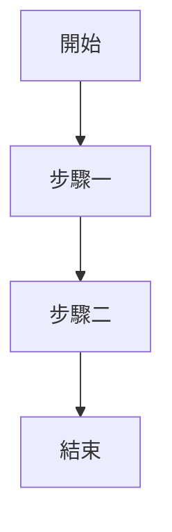
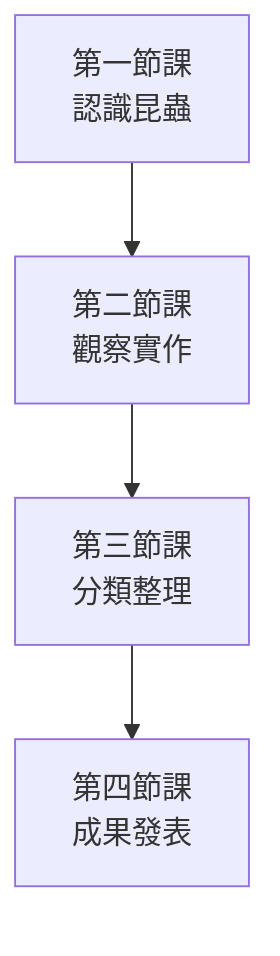
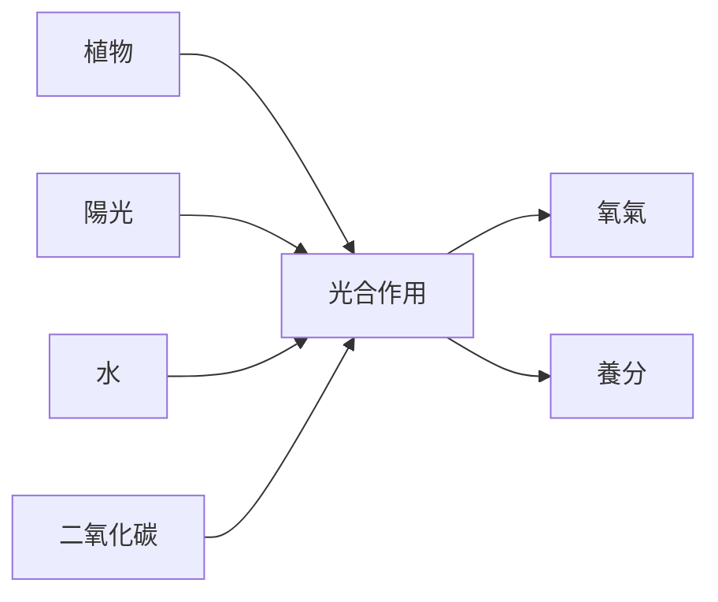
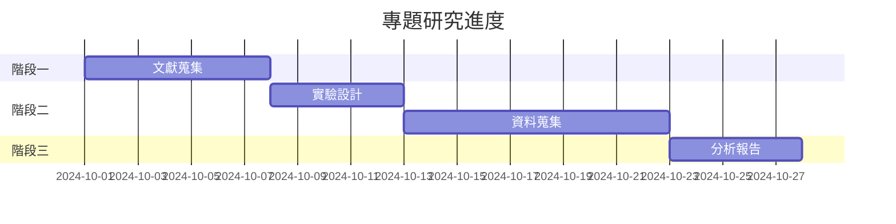
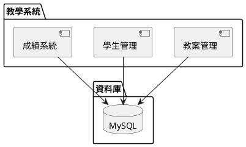
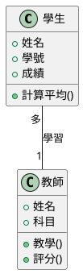
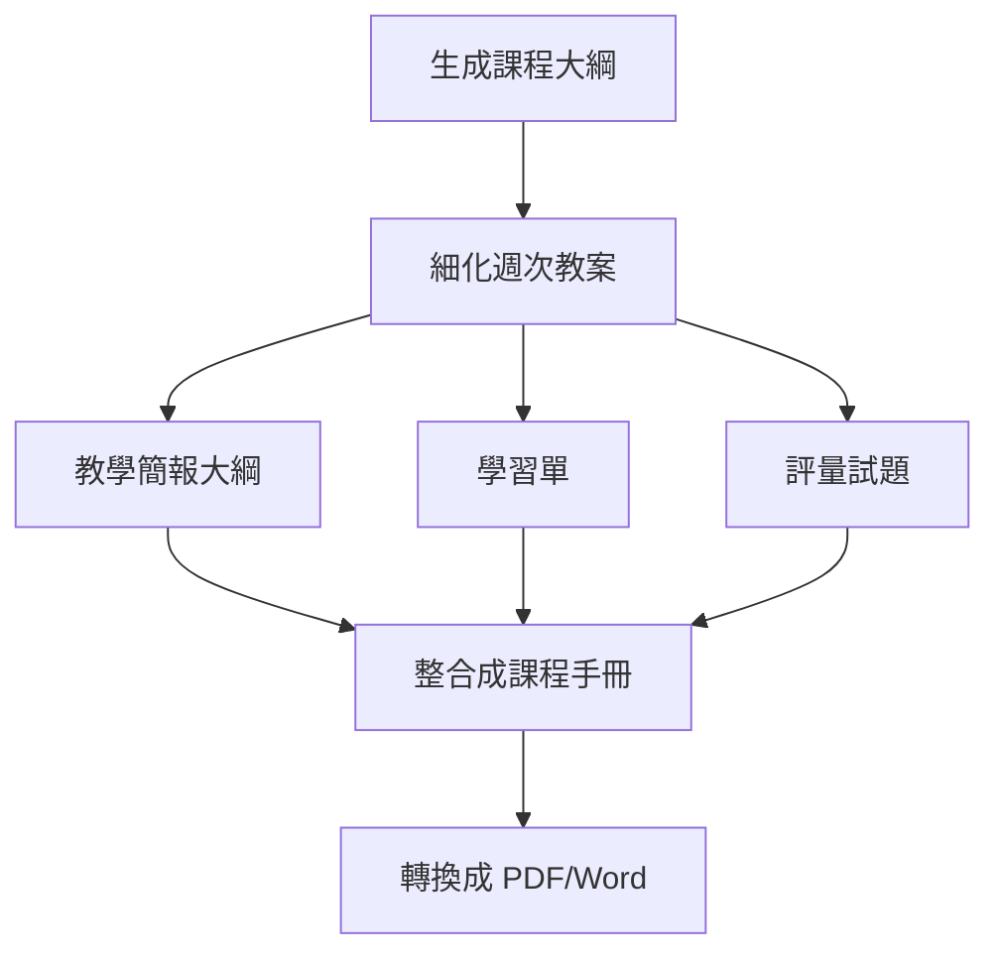

<!-- Path: AI_Agent_CLi | Updated: 2026-10-31 | Edition: Codex CLI / Claude Code -->
# 單元四補充內容：進階章節

> **本版查核：2026-10-31。**先閱讀[前導章：Agent 基本概念與工作環境](00_intro.html)，安裝並登入 Codex CLI 或 Claude Code 任選一款即可。本課使用虛構／去識別化資料，所有結果都要以來源與實際檔案驗收。


**銜接**：搭配[單元四](04_workspace.html)閱讀，練習多檔案、Markdown 與流程圖。

---

### 雙 CLI 操作約定

先在專案資料夾的終端機輸入 `codex` 或 `claude`，啟動其中一款工具。進入 CLI 會話後，直接輸入本章的自然語言提示；同一任務逐輪追問，不必每次重新啟動工具。

| 輸入位置 | 要做的事 | 範例 |
|---|---|---|
| 終端機 shell | 啟動一次 CLI，兩款擇一 | `codex` 或 `claude` |
| CLI 會話輸入區 | 說明任務、來源與產物 | 閱讀 lesson.txt，整理三個重點並標示來源。 |
| 同一會話輸入區 | 依剛才結果追問與修改 | 把第二個重點改寫成適合國小五年級的說明。 |

**專案指引檔**：Codex 使用 `AGENTS.md`，Claude Code 使用 `CLAUDE.md`。這些是保存專案慣例的檔案；設定方式及相容條件見[單元五](05_instructions.html)。

需要切換模型、查看用量或管理 context 時，使用 CLI 介面；兩款工具的常用斜線指令與差異見[前導章](00_intro.html)。寫檔前說清楚路徑與是否保留原稿，完成後在 VS Code 開啟產物核對。自然語言的「不要修改」是任務要求，不能取代權限設定。

## CLI + VSCode 整合的五大優勢

### 優勢一：一站式工作環境
**傳統方式**：
- 瀏覽器開 網頁 AI → 複製結果 → 貼到 Word → 存檔
- 需要在多個視窗間切換
- 容易遺失內容

**CLI + VSCode 方式**：
```
同一個視窗內：
├── 左側：檔案總管（看到所有教材）
├── 中間：編輯區（檢視與編輯內容）
└── 下方：終端機（與 AI 對話）
```

**效益**：工作可減少視窗切換；效益需以自己的任務時間紀錄評估

---

### 優勢二：批次處理多檔案（類似 NotebookLM）

**核心能力**：Codex CLI／Claude Code 可依指定路徑逐步讀檔並整合分析；先列出讀取清單，不能假定所有檔案都已進入 context

**情境範例**：整週教案統整

**資料夾結構**：
```
week5_lessons/
├── monday_math.txt
├── wednesday_science.txt
├── friday_social.txt
└── assessment.txt
```

**對話提示**：
```text
分析這個資料夾中的所有檔案，整理出本週的教學重點、學生表現與需改進之處
```

**要求 Agent 執行並確認紀錄**：
1. 讀取所有 4 個檔案
2. 整合資訊
3. 生成綜合報告

**vs NotebookLM 的差異**：

| 比較項目 | NotebookLM | Codex CLI／Claude Code + VSCode |
|---------|-----------|---------------------|
| **檔案管理** | 網頁上傳，分散 | 本機資料夾，集中 |
| **修改檔案** | 需重新上傳 | 下一次讀檔取得更新內容；已載入 context 需重讀 |
| **工作流程** | 瀏覽器 → 複製 → 貼上 | 終端機 → 直接輸出檔案 |
| **隱私性** | 雲端處理 | 工具在本機執行；提示與已讀資料仍可能送至雲端模型 |
| **整合性** | 獨立工具 | 整合在開發環境 |

---

### 優勢三：輸出結果可直接存檔

**傳統方式**：
1. AI 生成內容
2. 手動複製
3. 開啟 Word
4. 貼上
5. 調整格式
6. 存檔

**CLI 方式**：
```text
設計教案
請儲存為 lesson_plan.md；若已有同名檔案，先說明差異再詢問如何處理。
```
**完成後檢查**：確認寫檔紀錄成功、檔案非空且內容符合要求，再改名為正式稿。

---

### 優勢四：版本控制與歷程追蹤

**搭配 Git 使用**：以下是 Git 的終端機操作，請另開 shell 執行，不要貼進 AI 對話區。也可在 CLI 會話請 Agent 先說明差異，再協助完成相同的版本紀錄。
```bash
git add lesson_plan.md
git commit -m "AI生成初稿"

# 修改後
git add lesson_plan.md
git commit -m "調整難度"
```

**優點**：
- 追蹤每次修改
- 可回溯舊版本
- 團隊協作更容易

---

### 優勢五：自動化工作流程

**範例：每週整理教學週報**

進階任務仍在 CLI 會話中進行。先建立對應的週次資料夾（例如 `~/teaching/week_44/`）並放入本週來源，再請 Agent 把重複性的檔案整理做成腳本；內容摘要與修訂則留在對話中完成。

**第一輪：規劃可重複的流程**
```text
請先確認本週教學資料夾的實際路徑與週次，列出要讀取的檔案。
我每週都要整理教學重點、學生表現與待改進項目，最後產生 weekly_report_YYYYMMDD.md。
請規劃流程，區分適合腳本處理的檔案檢查、彙整，以及需要你閱讀後摘要的部分。
先說明，不要執行。
```

**第二輪：建立與檢查腳本**
```text
依剛才確認的流程，建立 weekly_report.sh，供 macOS／Linux／WSL 整理來源清單與檢查產物。
不要在腳本中啟動另一個 AI CLI；摘要由我們目前這個會話處理。
腳本須檢查資料夾是否存在、來源是否非空，避免覆寫已有週報；任何步驟失敗就停止並列出原因。
請逐段解釋腳本，並說明將讀取、建立或修改哪些檔案，先不要執行。
```

**第三輪：執行與產生週報**
```text
我已檢查剛才的腳本。請執行已確認的來源檢查與整理步驟，再讀取本週來源，生成週報草稿。
以實際日期命名為 weekly_report_YYYYMMDD.md，標出各段的來源檔名。
最後執行產物檢查，確認檔案非空，列出成功、失敗及待我核對的項目。
若缺檔或執行失敗，停在該步說明，不要宣稱週報已完成。
```

Windows PowerShell 使用者可以在第二輪改請 Agent 建立 `weekly_report.ps1`，說明相同檢查規則。每週在 CLI 對話指定該週資料夾後重用流程；這裡不設定無人值守的自動排程。

---

## Markdown 格式輸出的優勢與應用

### 什麼是 Markdown？

**簡單定義**：一種輕量級的標記語言，用簡單符號表示格式

**核心理念**：
- 純文字，任何編輯器都能開啟
- 語法簡單，5 分鐘上手
- 轉換方便，可轉成 PDF、Word、HTML

### Markdown 基本語法

```markdown
# 這是標題 1
## 這是標題 2
### 這是標題 3

**粗體文字**
*斜體文字*

- 項目一
- 項目二
  - 子項目

1. 第一點
2. 第二點

[連結文字](https://example.com)


```

### 為何用 Markdown 撰寫教材？

#### 優勢 1：專注內容，不被格式干擾

**Word 的問題**：
- 調整字體、大小、顏色
- 對齊、縮排
- 可能花費額外時間調整格式，請依實際作業記錄

**Markdown 的解法**：
- 只用符號標記
- 格式統一自動套用
- 專注在內容撰寫

#### 優勢 2：跨平台、容易保存

- 純文字較容易跨工具讀取，仍需保存編碼與外部資源
- 不依賴特定軟體（Word、Pages）
- 任何裝置都能編輯

#### 優勢 3：整合程式碼與圖表

**傳統方式**：
1. 用軟體畫流程圖
2. 截圖
3. 插入 Word
4. 修改？重新畫→截圖→插入

**Markdown + Mermaid**：
````markdown

````
**修改？直接改文字！**

---

### AI 輸出 Markdown 的範例

**在 CLI 會話輸入**：
```text
設計一份國小數學「分數加減」教案，用 Markdown 格式輸出，包含：
- 教學目標（條列）
- 教學流程（分段，用標題區分）
- 評量方式（表格呈現）
```

**AI 輸出**：
```markdown
# 分數加減教案

## 教學目標
- 學生能理解同分母分數相加
- 學生能運用分數解決生活問題
- 學生能說明分數加法的意義

## 教學流程

### 引起動機（10 分鐘）
使用披薩切片的例子...

### 發展活動（25 分鐘）
1. 教師示範...
2. 學生練習...

## 評量方式

| 評量項目 | 方式 | 佔分 |
|---------|------|------|
| 課堂練習 | 紙筆測驗 | 40% |
| 小組討論 | 觀察紀錄 | 30% |
| 回家作業 | 作業批改 | 30% |
```

---

### Markdown 進階應用：嵌入圖表

#### Mermaid：流程圖、架構圖

**範例：教學流程圖**
````markdown

````

**優點**：
- 文字描述就能生成圖表
- 修改方便
- 風格統一

---

## Mermaid vs PlantUML：差異與選擇

### 快速比較表

| 比較項目 | Mermaid | PlantUML |
|---------|---------|----------|
| **學習難度** | ⭐⭐ 簡單 | ⭐⭐⭐ 中等 |
| **圖表類型** | 流程圖、甘特圖、類別圖 | UML 全系列、架構圖 |
| **渲染方式** | 瀏覽器即時渲染 | 需要外部工具 |
| **適用對象** | 教師、一般用途 | 軟體工程師 |
| **VSCode 支援** | 內建預覽 | 需安裝擴充 |
| **適合情境** | 教學流程、概念圖 | 系統架構、程式設計 |

### Mermaid 適用情境

#### 1. 教學流程圖


#### 2. 概念關係圖


#### 3. 甘特圖（進度規劃）


### PlantUML 適用情境

#### 1. 系統架構圖


#### 2. 類別圖（程式設計用）


### 教師實務建議

**建議使用 Mermaid，理由：**
1. ✅ 學習曲線平緩，30 分鐘上手
2. ✅ VSCode 原生支援，即時預覽
3. ✅ 足夠應付教學需求（流程、概念圖）
4. ✅ Markdown 直接嵌入，不需額外工具

**PlantUML 適合：**
- 資訊科技老師
- 需要繪製軟體架構
- 專案管理複雜圖表

---

## 完整實戰案例：從大綱到完整教材設計

### 情境：設計「大型語言模型」教學教材

**對象**：高中資訊科技課程
**時間**：4 週，每週 2 小時

---

### 階段一：生成教學大綱

**檔案準備**：
在 VS Code 建立並開啟 `llm_course/`，終端機也切換至此資料夾，再用 `codex` 或 `claude` 啟動一次。以下六個階段在同一會話逐步進行，所有檔案採同一層目錄。每階段完成後先開啟產物核對，再送出下一個提示；不要假定對話中顯示的文字已經寫入檔案。

**在 CLI 會話輸入**：
```text
我要為高中生設計『大型語言模型入門』課程，共 4 週。

請生成課程大綱，以 Markdown 格式輸出：

## 課程名稱
## 目標學生
## 課程目標（3-5 點）
## 週次規劃

### 第一週：
- 主題
- 重點概念
- 教學活動

### 第二週：
...

請以 Markdown 格式完整輸出。
請儲存為 course_outline.md；若已有同名檔案，先說明差異再詢問如何處理。
```

**生成結果**（部分）：
```markdown
# 大型語言模型入門課程

## 目標學生
高中一、二年級，具備基本電腦操作能力

## 課程目標
- 理解 AI 與大型語言模型的基本概念
- 能操作並評估 AI 工具（如 ChatGPT）
- 認識 AI 的應用與倫理議題
- 培養批判思考與資訊素養

## 週次規劃

### 第一週：認識 AI 與語言模型
**主題**：什麼是 AI？語言模型如何運作？

**重點概念**：
- AI、機器學習、深度學習的關係
- 語言模型的訓練方式
- Transformer 架構（簡化說明）

**教學活動**：
1. 破冰：讓學生試用 ChatGPT，紀錄驚訝與疑問
2. 講解：用比喻說明 AI 如何學習語言
3. 實作：設計不同提示詞，觀察 AI 回應差異

---

### 第二週：提示工程（Prompt Engineering）
...
```

---

### 階段二：根據大綱細化每週教材

**針對第一週，生成詳細教案**：

**在 CLI 會話輸入**：
```text
根據 course_outline.md 的第一週內容，設計完整的 2 小時教案。

輸出格式（Markdown）：
# 第一週教案：認識 AI 與語言模型

## 教學目標
## 教學準備
## 教學流程（分段，含時間）
### 引起動機（15 分鐘）
### 概念講解（30 分鐘）
### 實作活動（40 分鐘）
### 討論與總結（20 分鐘）
### 休息與轉場（15 分鐘）
## 學習單設計
## 評量方式
## 延伸閱讀

請生成完整內容。
請儲存為 week1_lesson_plan.md；若已有同名檔案，先說明差異再詢問如何處理。
```

---

### 階段三：生成教學簡報大綱

**在 CLI 會話輸入**：
```text
根據 week1_lesson_plan.md，設計一份教學簡報大綱（15-20 頁）。

以 Markdown 列表方式輸出，每個項目是一頁投影片的標題與重點：

## 投影片大綱

### 第 1 頁：課程標題
- 標題：認識 AI 與語言模型
- 副標題：探索 ChatGPT 背後的科學

### 第 2 頁：破冰活動
- 提問：你用過哪些 AI 工具？
- 互動：掃碼體驗 ChatGPT

...

請包含流程圖建議（用 Mermaid 語法）
請儲存為 week1_slides_outline.md；若已有同名檔案，先說明差異再詢問如何處理。
```

---

### 階段四：生成學習單

**在 CLI 會話輸入**：
```text
根據 week1_lesson_plan.md，設計一份學習單。

格式：
# 學習單：認識 AI 與語言模型

## 第一部分：課前暖身（3 題）
## 第二部分：實作紀錄
### 任務一：設計 3 個提示詞
| 提示詞 | AI 回應摘要 | 你的觀察 |
|--------|------------|---------|
| ... | ... | ... |

## 第三部分：反思問題（2 題）
## 第四部分：延伸挑戰（選做）

請以 Markdown 表格與條列方式輸出完整內容。
請儲存為 week1_worksheet.md；若已有同名檔案，先說明差異再詢問如何處理。
```

---

### 階段五：生成評量試題

**在 CLI 會話輸入**：
```text
根據 week1_lesson_plan.md，設計評量題目。

# 第一週評量

## 選擇題（5 題）
測驗基本概念理解

## 簡答題（3 題）
測驗應用與思考

## 實作題（1 題）
設計一個教學情境的 AI 應用，並說明提示詞設計

請附標準答案與評分標準。
請儲存為 week1_assessment.md；若已有同名檔案，先說明差異再詢問如何處理。
```

---

### 階段六：整合所有檔案

**資料夾結構**（第一週完成後，與上面提示指定的檔名一致）：
```
llm_course/
├── course_outline.md
├── week1_lesson_plan.md
├── week1_slides_outline.md
├── week1_worksheet.md
└── week1_assessment.md
```

其他週次請同樣建立對應檔案後再整合；不存在的週次不可讓 AI 補寫成「已完成」。

**最後整合提示**：
```text
統整目前資料夾中 course_outline.md 與 week1_ 開頭的檔案，生成一份『完整課程手冊』，包含：
- 目錄（自動生成連結）
- 課程概覽
- 各週教學內容（引用各檔案）
- 附錄（參考資源、延伸閱讀）

請整理手冊 Markdown 內容。
請儲存為 course_handbook.md；若已有同名檔案，先說明差異再詢問如何處理。
```

---

### 完整流程圖



---

### 時間效益分析（課堂試算，非實測保證）

| 任務 | 傳統方式 | AI + CLI 方式 | 節省時間 |
|------|---------|--------------|---------|
| 課程大綱 | 2 小時 | 5 分鐘 + 調整 15 分鐘 | 約 83% |
| 單週教案 | 3 小時 | 10 分鐘 + 調整 30 分鐘 | 約 78% |
| 學習單 | 1.5 小時 | 5 分鐘 + 調整 20 分鐘 | 約 72% |
| 評量設計 | 2 小時 | 10 分鐘 + 調整 30 分鐘 | 約 67% |
| **表內四項合計** | **8.5 小時** | **2 小時 5 分鐘** | **約 75%（試算）** |

---

## 實用對話提示總結

以下提示都輸入在已啟動的 CLI 會話中。需要整理 context、續接會話或查看模型與用量時，參考[前導章](00_intro.html)的工具對照。

### 多檔案整合分析

**先指定範圍，再確認已讀來源：**
```text
請列出這個資料夾中可供分析的教學檔案，讀取後生成摘要，並標出每個重點的來源檔名。
```

**只需部分檔案時，縮小範圍：**
```text
這次只整合 file1.txt、file2.txt、file3.txt 的內容，先列出它們的共通點與差異。
```

### 輸出為 Markdown 檔案

**第一輪：建立初稿**
```text
依我們剛才確認的教學目標與來源生成教案，儲存為 lesson.md。
若同名檔案已存在，先列出現況並讓我確認處理方式。
```

**第二輪：修改同一份產物**
```text
請重新讀取 lesson.md，依教學目標生成評量，加入檔案末尾的「評量」段落。
保留既有教案，完成後列出新增內容，讓我核對。
```

### 使用 Mermaid 圖表
```text
設計教學流程，用 Mermaid 流程圖呈現，儲存為 flow.md。
若已有同名檔案，先說明差異再詢問如何處理。
```

### 批次處理

**第一輪：確認每個單元的輸入與輸出**
```text
請檢查 unit1、unit2、unit3 資料夾各自的 source.md。
列出來源是否存在、是否有內容，以及預計產生的 unit1_plan.md、unit2_plan.md、unit3_plan.md。
每份教案只能依對應單元的來源撰寫；缺少來源就先列為待處理，不要補造內容。
```

**第二輪：建立可重複使用的檢查腳本**
```text
請建立適合目前作業系統的腳本，檢查這三組來源與產物，並說明怎麼判定成功或失敗。
不要在腳本中啟動另一個 AI CLI；教案內容仍由目前會話依來源生成。
遇到缺檔、空檔或既有同名產物須列出原因，不要覆寫。先給我檢查腳本與計畫。
```

**第三輪：逐項執行並驗收**
```text
依剛才確認的計畫逐單元讀取 source.md，生成對應教案並儲存。
完成一個單元後先檢查產物，再處理下一個；全部完成後執行檢查腳本。
請列出各單元的來源、產物路徑、檢查結果與待處理事項，不把失敗後留下的空檔當成完成。
```

### PowerShell 7 批次操作對照

在 Windows 上，用相同的對話流程交代平台即可，不必背誦不同的迴圈語法：

```text
我的環境是 Windows PowerShell 7，請將剛才的來源與產物檢查腳本寫成 .ps1。
使用 unit1、unit2、unit3 各自的 source.md，檢查對應的 unit1_plan.md、unit2_plan.md、unit3_plan.md。
外部程式失敗時須檢查結束狀態，停止並說明原因；檔案存在但沒有內容也不能算成功。
先解釋腳本；我檢查後，再請你執行。
```

**跨平台驗收重點**：來源、產物名稱與教學要求保持一致；差異只在腳本語法。若中途需要更換模型或整理 context，先把完成清單與待處理事項保存為 `progress.md`，之後請 Agent 重新讀取再繼續。

---

**學習銜接**：完成後回到[單元四](04_workspace.html)的練習任務。
