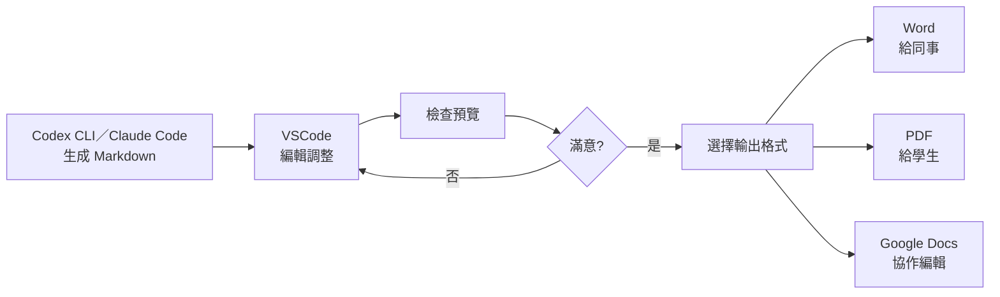

<!-- Path: AI_Agent_CLi | Updated: 2026-10-31 | Edition: Codex CLI / Claude Code -->
# 單元六補充內容：進階應用

> **閱讀前提：**先完成[前導章：Agent 基本概念與工作環境](00_intro.html)，使用 Codex CLI 或 Claude Code 其中一款。本章以備課作為範例情境；不是教師也能把主題換成自己的工作或學習內容。範例請使用虛構或去識別化資料，結果都要回到來源與實際檔案確認。（查核日期：2026-10-31）


**銜接**：搭配[單元六](06_lesson_plans.html)閱讀，練習文件轉換與虛構成績資料分析。

---

### 雙 CLI 操作約定

在專案資料夾開啟終端機，輸入 `codex` 或 `claude` 任選一款，啟動一次互動會話。接著把本章的「對話提示」貼入 CLI 的對話輸入區；每輪檢查回覆，再在同一會話追問，不需反覆回到終端機重啟工具。

```text
請先閱讀 lesson.txt，列出三個教學重點及來源段落。
```

確認內容後繼續說：「把第二點改寫成適合國小五年級的說明。」需要保存時，直接指定檔名並要求回報實際寫入位置；已有同名檔案時先比較差異，再決定更新或另存新版本。檔案寫入與程式執行仍受工具權限控制。

**會話管理**：長任務也在 CLI 中進行。模型選擇、用量、context 整理與會話續接的常用指令，見[前導章的 CLI 互動操作與指令速查](00_intro.html)。切換主題或壓縮 context 前，先將已確認的目標、檔案與待辦保存，續接後核對摘要。

**專案指引檔**：Codex 使用 `AGENTS.md`；Claude Code 使用 `CLAUDE.md`。它們是專案內的文字檔，不是需要輸入的操作指令。作用範圍、相容條件與驗證方式見[單元五](05_instructions.html)。


## Markdown 轉換應用：從 AI 輸出到實用文件

### 為何從 Markdown 開始？

先在 CLI 對話交代要轉換的檔案與格式，例如：

```text
請檢查 lesson_plan.md，協助轉成 lesson_plan.docx。
先確認 Pandoc 與所需範本是否可用，說明轉換方式，再執行轉換並回報產物。
若有圖表或格式無法保留，請指出需要另外處理的項目。
```

以下 Pandoc 命令與設定檔是核對 Agent 執行內容的參考；日常操作可繼續在對話中請它完成。安裝命令在終端機執行，或在了解安裝範圍後授權 Agent 執行，不把它們當成對話提示。

**核心優勢**：
1. **AI 天然輸出格式**：可明確要求 Codex CLI／Claude Code 輸出 Markdown；仍需檢查格式
2. **易於編輯**：純文字，VSCode 直接編輯
3. **靈活轉換**：可轉成 PDF、Word、PowerPoint、HTML

---

### 轉換方式一：Markdown → Word

#### 方法 A：使用 Pandoc（產出 Word 時使用）

**安裝 Pandoc**：依作業系統選一種安裝方式，完成後執行 `pandoc --version`。以下安裝命令依 [Pandoc 官方文件](https://pandoc.org/installing.html) 查核（2026-10-31）。

macOS（Homebrew）：

```bash
brew install pandoc
```

Windows PowerShell（WinGet）：

```powershell
winget install --source winget --exact --id JohnMacFarlane.Pandoc
```

**基本轉換**：
```bash
pandoc lesson_plan.md -o lesson_plan.docx
```

**進階：套用樣式範本**：
```bash
# 先創建參考範本
pandoc lesson_plan.md -o template.docx

# 在 Word 中調整 template.docx 的樣式（標題字體、間距等）

# 使用範本轉換其他文件
pandoc new_lesson.md --reference-doc=template.docx -o new_lesson.docx
```

**批次轉換的對話提示**：
```text
請列出目前資料夾中的 Markdown 檔案，使用 my_template.docx 作為樣式範本，
規劃逐檔轉成同名 DOCX 的腳本。先列出輸入與輸出對應，檢查是否會覆寫既有檔案。
我確認後先轉一份檢查版面，再完成其餘檔案，最後列出成功與失敗清單。
```

---

#### 方法 B：線上工具（無需安裝）

**選讀工具（上傳前確認服務與資料政策）**：
1. **Dillinger** (https://dillinger.io/)
   - 線上編輯 Markdown
   - 匯出能力以目前介面為準；本課以本機 Pandoc 產生 DOCX

2. **Markdown to Word Converter** (https://markdowntoword.com/)
   - 上傳 MD 檔
   - 下載 DOCX

**操作步驟**：
1. 開啟 VSCode 中的 `.md` 檔案
2. 全選複製 (Ctrl+A, Ctrl+C)
3. 貼到線上工具
4. 點選「Export to Word」
5. 下載檔案

---

#### 方法 C：VSCode 擴充套件（快速產出 PDF 時使用 Markdown PDF）

VSCode 提供多種擴充套件，從簡單到進階，滿足不同需求：

---

##### 📌 簡單方案：Markdown PDF（最快上手）

**特點**：從命令面板匯出 PDF，也支援 HTML、PNG、JPEG。需有可用 Chromium／Chrome／Edge；首次使用可能下載瀏覽器。

**安裝步驟**：
1. VSCode 左側點選「擴充功能」（或按 `Ctrl+Shift+X`）
2. 搜尋「Markdown PDF」（作者：yzane）
3. 點選「安裝」

**使用方式**：
1. 開啟 `.md` 檔案
2. 按 `Ctrl+Shift+P`（Mac: `Cmd+Shift+P`）開啟命令面板
3. 輸入「Markdown PDF: Export (pdf)」
4. 按 Enter，PDF 自動生成在同一資料夾

**優點**：
- ✅ 可由命令面板操作；依電腦環境設定瀏覽器與字型
- ✅ 支援中文
- ✅ 自動處理圖片與表格

**限制**：
- ⚠️ 不直接輸出 DOCX
- ⚠️ 目前支援 Mermaid、PlantUML 與 KaTeX，但仍需檢查圖表載入及列印換頁

[Markdown PDF 官方 Marketplace 說明](https://marketplace.visualstudio.com/items?itemName=yzane.markdown-pdf)（2026-10-31 查核）。

**適用情境**：快速產出 PDF 講義給學生

---

##### 📌 中階方案：Markdown All in One（多功能）

**特點**：Markdown 編輯神器 + 轉 HTML

**安裝步驟**：
1. 搜尋「Markdown All in One」（作者：Yu Zhang）
2. 安裝

**主要功能**：
- 即時預覽（`Ctrl+K V`）
- 自動目錄生成
- 表格格式化
- **轉換成 HTML**（可再轉 Word）

**轉 HTML 步驟**：
1. 開啟 `.md` 檔案
2. `Ctrl+Shift+P` → 「Markdown: Print current document to HTML」
3. 生成 `.html` 檔案
4. 用瀏覽器預覽；需 Word 時另用 `pandoc input.html -o output.docx`，不能假設瀏覽器「另存為」可產生 DOCX

**優點**：
- ✅ 編輯功能強大
- ✅ HTML 保留標題與基本結構；複雜格式仍需檢查
- ✅ 可自訂 CSS 樣式

**適用情境**：需要精細控制格式的教材製作

---

##### 📌 進階方案：Markdown Preview Enhanced（專業級）

**特點**：功能最完整，支援多種輸出格式與進階功能

**安裝步驟**：
1. 搜尋「Markdown Preview Enhanced」（作者：Yiyi Wang）
2. 安裝

**開啟預覽**：
- 方法 1：`Ctrl+K V`（側邊預覽）
- 方法 2：右鍵 → 「Markdown Preview Enhanced: Open Preview」

**轉換步驟**：
1. 在預覽視窗右鍵
2. 依目前擴充版本的匯出選單操作；Pandoc 類輸出需另備 Pandoc，PDF 需相應引擎
3. 選擇輸出格式：
   - **PDF**
   - **Word** (.docx)
   - **HTML**
   - **PNG/JPEG**（整頁截圖）
   - **ePub**（電子書格式）
   - **Presentation**（簡報模式）

**進階功能**：

**1. 支援 Mermaid 圖表**
````markdown

````
→ 預覽與輸出時自動轉成圖片！

**2. 支援數學公式**
```markdown
$$
E = mc^2
$$
```
→ 使用 KaTeX/MathJax 渲染

**3. 程式碼執行**（進階）
- 可在 Markdown 中執行 Python、JavaScript 程式碼
- 結果直接顯示在文件中

**4. 自訂 CSS 樣式**
- 建立 `style.less` 檔案
- 客製化輸出的 PDF/HTML 樣式

**優點**：
- ✅ 功能最完整
- ✅ 支援 Mermaid、數學公式
- ✅ 多種輸出格式
- ✅ 高度可自訂

**限制**：
- ⚠️ 學習曲線稍高
- ⚠️ 需要安裝額外工具（如 Puppeteer for PDF）

**適用情境**：
- 製作含圖表的專業教材
- 需要多種格式輸出
- 追求完美排版

---

##### 📌 專家方案：Pandoc + VSCode Tasks（完全自動化）

**特點**：最強大，但需要設定

**前置需求**：
1. 已安裝 Pandoc（參考前面的安裝說明）
2. 熟悉 VS Code Tasks；已建立 `template.docx` 與 `style.css`
3. PDF 任務另需安裝 XeLaTeX 與 xeCJK 套件，`CJKmainfont` 改為本機實際存在的中文字型（Windows 可用 `Microsoft JhengHei`，macOS 可用 `PingFang TC`）

**設定步驟**：

**1. 建立 Tasks 設定檔**

先在 CLI 對話請 Agent 依目前環境建立設定：

```text
請檢查 Pandoc、XeLaTeX、中文字型、template.docx 與 style.css 是否可用，
為目前專案建立 .vscode/tasks.json，提供 Markdown to Word、Markdown to PDF、
Markdown to HTML 三個任務。請先解釋輸入輸出路徑與參數，不覆寫既有設定。
若缺少工具或字型，列出待補項目，不要先執行轉換。
```

以下是可供比對的 `.vscode/tasks.json` 範例；PDF 字型須依本機環境調整：

```json
{
  "version": "2.0.0",
  "tasks": [
    {
      "label": "Markdown to Word",
      "type": "shell",
      "command": "pandoc",
      "args": [
        "${file}",
        "-o",
        "${fileDirname}/${fileBasenameNoExtension}.docx",
        "--reference-doc=template.docx"
      ],
      "group": "build",
      "presentation": {
        "reveal": "always",
        "panel": "new"
      }
    },
    {
      "label": "Markdown to PDF",
      "type": "shell",
      "command": "pandoc",
      "args": [
        "${file}",
        "-o",
        "${fileDirname}/${fileBasenameNoExtension}.pdf",
        "--pdf-engine=xelatex",
        "-V",
        "CJKmainfont=Noto Sans CJK TC"
      ],
      "group": "build"
    },
    {
      "label": "Markdown to HTML",
      "type": "shell",
      "command": "pandoc",
      "args": [
        "${file}",
        "-o",
        "${fileDirname}/${fileBasenameNoExtension}.html",
        "--standalone",
        "--css=style.css"
      ],
      "group": "build"
    }
  ]
}
```

**2. 使用方式**：
1. 開啟 `.md` 檔案
2. 按 `Ctrl+Shift+P` → 「Tasks: Run Task」
3. 選擇「Markdown to Word」或其他任務
4. 自動執行轉換！

**3. 快捷鍵綁定（選用）**

在 `keybindings.json` 中加入：
```json
[
  {
    "key": "ctrl+shift+w",
    "command": "workbench.action.tasks.runTask",
    "args": "Markdown to Word"
  },
  {
    "key": "ctrl+alt+p",
    "command": "workbench.action.tasks.runTask",
    "args": "Markdown to PDF"
  }
]
```

**優點**：
- ✅ 完全自動化
- ✅ 可批次處理
- ✅ 統一團隊工作流程
- ✅ 版本控制（設定檔可共享）

**適用情境**：
- 團隊協作
- 大量文件轉換需求
- 追求效率的進階使用者

---

##### 📊 方案比較表

| 方案 | 難度 | 輸出格式 | Mermaid | 數學公式 | 自訂樣式 | 推薦對象 |
|------|------|---------|---------|---------|---------|---------|
| **Markdown PDF** | ⭐ 簡單 | PDF／HTML／PNG／JPEG | ✅ | ✅ KaTeX | ✅ CSS | 初學者 |
| **Markdown All in One** | ⭐⭐ 中等 | HTML | ❌ | ⭐ 基本 | ⭐ 基本 | 一般使用者 |
| **Preview Enhanced** | ⭐⭐⭐ 進階 | 多種 | ✅ | ✅ | ✅ | 進階使用者 |
| **Pandoc + Tasks** | ⭐⭐⭐⭐ 專家 | 全部 | ⚠️ 需處理 | ✅ | ✅ | 專業用戶 |

---

##### 💡 實務建議

**情境 1：快速產出 PDF 講義**
→ 使用 **Markdown PDF**，一鍵完成

**情境 2：教案包含流程圖**
→ 使用 **Markdown Preview Enhanced**，完整支援 Mermaid

**情境 3：需要 Word 格式給同事協作**
→ 使用 **Pandoc + 範本**，保持格式一致

**情境 4：大量文件轉換**
→ 設定 **VSCode Tasks**，批次自動化處理

---

##### 🔧 常見問題排解

**Q1：PDF 中文顯示亂碼？**
A：使用 Pandoc 時加入中文字型參數：
```bash
pandoc file.md -o file.pdf --pdf-engine=xelatex -V CJKmainfont="Noto Sans CJK TC"
```
字型請改成本機有的中文字型：Windows 可用 `Microsoft JhengHei`，macOS 可用 `PingFang TC`。

**Q2：Mermaid 圖表無法轉換？**
A：
- 方法 1：使用 Markdown Preview Enhanced（原生支援）
- 方法 2：先將圖表截圖，插入 Markdown 後再轉換

**Q3：Word 轉換後格式跑掉？**
A：
- 使用 Pandoc 的 `--reference-doc` 參數，套用範本樣式
- 或用 Pandoc 將 HTML 轉 DOCX；也可用 Word 開啟 HTML 後另存 DOCX，並檢查格式

**Q4：如何批次轉換多個檔案？**
A：在同一 CLI 會話請 Agent 建立批次轉換流程：
```text
請將目前資料夾的 Markdown 逐檔轉為同名 DOCX，先列出對應檔案與可能的覆寫衝突。
請建立適合目前作業系統的腳本，供我確認後試跑一份，再處理其餘檔案。
每份都記錄是否成功，失敗時保留原因，不將空檔當成完成。
```

---

##### 📚 延伸資源

**官方文件**：
- Markdown Preview Enhanced: https://shd101wyy.github.io/markdown-preview-enhanced/
- Pandoc User Guide: https://pandoc.org/MANUAL.html

---

### 轉換方式二：Markdown → Google Docs

#### 方法 A：透過 Google Docs 匯入

依 [Google 官方 Markdown 說明](https://support.google.com/docs/answer/12014036?hl=en) 開啟 `.md`；新版也可能以 [Markdown 模式](https://support.google.com/docs/answer/18289341?hl=en) 保留原格式，不把開啟等同自動轉換（查核 2026-10-31）。

**步驟**：
1. 開啟 Google Docs
2. 檔案 → 開啟 → 上傳（File → Open → Upload）
3. 選擇 `.md` 檔案
4. 確認目前是 Markdown 模式或已轉為 Google 文件；如需 Google 文件格式，另建 Google 文件，用「Paste from Markdown」貼入內容，再核對格式

**優點**：
- 簡單快速
- 保留基本格式
- 雲端協作方便

**限制**：
- 進階格式可能跑掉（如 Mermaid 圖表）
- 需手動調整樣式

---

#### 方法 B：透過 Google Apps Script 自動化

**進階用途**：以文字建立 Google Docs 的最小示例；只處理一級、二級標題與一般段落，不會完整轉換表格、圖片、清單或程式碼區塊。使用前需在 Google Apps Script 授權文件存取；正式格式轉換優先使用 DOCX 匯入。[DocumentApp 官方參考](https://developers.google.com/apps-script/reference/document/document-app)。

**腳本範例**（Google Apps Script）：
```javascript
function markdownToGoogleDocs(markdownText, docName) {
  var doc = DocumentApp.create(docName);
  var body = doc.getBody();

  // 簡單的 Markdown 解析
  var lines = markdownText.split('\n');
  lines.forEach(function(line) {
    if (line.startsWith('# ')) {
      body.appendParagraph(line.substring(2)).setHeading(DocumentApp.ParagraphHeading.HEADING1);
    } else if (line.startsWith('## ')) {
      body.appendParagraph(line.substring(3)).setHeading(DocumentApp.ParagraphHeading.HEADING2);
    } else {
      body.appendParagraph(line);
    }
  });

  return doc.getUrl();
}
```

---

### 轉換方式三：Markdown → PDF

#### 方法 A：使用 Pandoc

中文 PDF 需要指定 PDF 引擎與中文字型，另需安裝 XeLaTeX 與 xeCJK 套件（精簡版 TeX 可能未內含）：

```bash
pandoc lesson_plan.md -o lesson_plan.pdf --pdf-engine=xelatex -V CJKmainfont="Noto Sans CJK TC"
```

字型請改成本機有的中文字型：Windows 可用 `Microsoft JhengHei`，macOS 可用 `PingFang TC`。

#### 方法 B：VSCode + Markdown Preview Enhanced

在預覽視窗：右鍵 → Export → PDF

#### 方法 C：線上工具

- **Markdown to PDF** (https://md2pdf.netlify.app/)
- **CloudConvert** (https://cloudconvert.com/md-to-pdf)

---

### 完整工作流程：AI 生成 → 編輯 → 轉換 → 分享



---

### 格式保留與注意事項

#### ✅ 通常能正確轉換的元素

- 標題（H1-H6）
- 粗體、斜體
- 列表（有序、無序）
- 連結
- 圖片（需確認路徑）
- 表格

#### ⚠️ 可能需要手動調整的元素

- **Mermaid 圖表**：需先轉成圖片再插入
- **程式碼區塊**：在 Word 中可能格式跑掉
- **複雜表格**：需手動調整欄寬
- **數學公式**：需使用 LaTeX 語法

#### 💡 實用技巧

**保留 Mermaid 圖表的方式**：
1. 在 VSCode 中開啟 Markdown
2. 預覽 Mermaid 圖表
3. 截圖或右鍵儲存為圖片
4. 在 Markdown 中用 `` 插入
5. 再轉換成 Word/PDF

---

## 成績處理應用：AI 輔助評分與分析

### 重要提醒：AI 的角色與限制

**✅ AI 可以協助**：
- 分析成績分布
- 計算統計數據
- 生成報表
- 提供評分建議

**❌ AI 不應完全取代**：
- 教師的專業判斷
- 學生個別差異考量
- 質性評估

**隱私原則**：
- 去識別化（移除學生姓名、學號）
- CLI 不等於離線推論；本課只用虛構資料，真實成績需依學校政策選擇核准的資料處理方式
- 僅用於分析，不公開

---

### 應用一：批改選擇題與簡答題

#### 情境：自動批改客觀題

**檔案準備**：`answer_key.txt`
```
1. B
2. A
3. D
4. C
5. A
6. B
7. D
8. A
9. C
10. B
```

**學生答案**：`student_001_answers.txt`
```
1. B
2. A
3. C
4. C
5. A
6. B
7. D
8. D
9. C
10. B
```

**批改提示**：
**對話提示（在同一個 CLI 會話中輸入）**
```text
比較 answer_key.txt 和 student_001_answers.txt，計算正確題數與分數（每題 10 分）。列出答錯的題號。

請將結果保存為 student_001_score.txt，完成後回報路徑及核對結果。
```

**輸出結果**：
```
批改結果：
- 答對：8 題
- 答錯：2 題（第 3 題、第 8 題）
- 分數：80 分

答錯題目：
- 第 3 題：學生答 C，正確答案 D
- 第 8 題：學生答 D，正確答案 A

建議：針對這兩題的概念進行補救教學。
```

---

#### 情境：簡答題評分輔助

**標準答案**：`rubric.txt`
```
題目：說明光合作用的過程

評分標準：
- 提到「陽光」：2 分
- 提到「水」：2 分
- 提到「二氧化碳」：2 分
- 說明「產生氧氣與葡萄糖」：2 分
- 解釋過程步驟：2 分

總分：10 分
```

**學生答案**：`student_answer.txt`
```
植物需要陽光和水進行光合作用，會產生氧氣。葉綠素吸收陽光的能量，將二氧化碳和水轉換成葡萄糖。
```

**評分提示**：
**對話提示（在同一個 CLI 會話中輸入）**
```text
根據 rubric.txt 的評分標準，為 student_answer.txt 評分。列出給分項目與理由。
```

**AI 輸出**：
```
評分結果：

✓ 提到「陽光」：2 分
✓ 提到「水」：2 分
✓ 提到「二氧化碳」：2 分
✓ 說明「產生氧氣與葡萄糖」：2 分（有提到氧氣和葡萄糖）
△ 解釋過程步驟：1 分（有說明轉換過程，但不夠詳細）

總分：9 / 10 分

建議：
- 學生掌握了核心概念
- 可再加強過程的詳細步驟說明
```

---

### 應用二：計算學期成績

#### 檔案準備：`grades.csv`

```csv
代號,平時成績,期中考,期末考,作業,出席
學生A,85,78,82,90,100
學生B,90,85,88,95,100
學生C,75,70,68,80,95
學生D,88,92,90,85,100
學生E,70,65,70,75,90
```

#### 計算總成績（加權）

**計算規則**：
- 平時成績：20%
- 期中考：25%
- 期末考：30%
- 作業：20%
- 出席：5%

**對話提示（在同一個 CLI 會話中輸入）**
```text
根據 grades.csv，計算每位學生的總成績。

計算方式：
- 平時成績 × 20%
- 期中考 × 25%
- 期末考 × 30%
- 作業 × 20%
- 出席 × 5%

輸出格式：
| 代號 | 總成績 | 等第 |
|------|--------|------|
| ... | ... | ... |

等第標準：
- A：90以上
- B：80 ≤ 分數 < 90
- C：70 ≤ 分數 < 80
- D：60 ≤ 分數 < 70
- F：分數 < 60

請將結果保存為 final_grades.md，完成後回報路徑及核對結果。
```

---

### 應用三：成績分析與視覺化

#### 分析成績分布

**對話提示（在同一個 CLI 會話中輸入）**
```text
分析 grades.csv 的成績分布：

1. 計算各科目的平均分、最高分、最低分、標準差
2. 列出需要加強的學生（總成績低於 70）
3. 分析各評量項目的相關性（哪些項目表現相似）
4. 提供教學建議

輸出為 Markdown 報表格式。

請將結果保存為 grade_analysis.md，完成後回報路徑及核對結果。
```

**已核對的示例（母體標準差取一位小數，非實際學生資料）**：
```markdown
# 學期成績分析報告

## 一、整體統計

| 項目 | 平均分 | 最高分 | 最低分 | 標準差 |
|------|--------|--------|--------|--------|
| 平時成績 | 81.6 | 90 | 70 | 7.8 |
| 期中考 | 78.0 | 92 | 65 | 9.8 |
| 期末考 | 79.6 | 90 | 68 | 9.1 |
| 作業 | 85.0 | 95 | 75 | 7.1 |
| 出席 | 97.0 | 100 | 90 | 4.0 |

## 二、需關注學生

- 學生C：總成績 73.65，建議加強期中考與期末考表現
- 學生E：總成績 70.75，可檢視期中考題型；本例沒有總成績低於 70 的學生

## 三、項目相關性分析

- 這五列中平時與期末成績呈正相關（r 約 0.95）；樣本很小，不能推論因果
- 這是同一加權公式的組成項，不能由相關性推論作業造成成績提升
- 出席率普遍良好

## 四、教學建議

1. 加強形成性評量，先核對錯題與教學活動，不由五列相關性推論預測能力
2. 針對學生C、E 進行個別輔導
3. 鼓勵作業確實完成，再由教師觀察其與學習困難的關係
```

---

### 應用四：作文批改輔助

**注意**：AI 輔助，但不取代教師判斷

#### 快速給予回饋建議

**學生作文**：`essay.txt`

**評分向度**：`writing_rubric.txt`
```
評分項目：
1. 內容（30%）：主題明確、內容充實
2. 組織（25%）：結構完整、段落分明
3. 用詞（25%）：詞彙豐富、表達清晰
4. 文法（20%）：句子正確、標點適當
```

**對話提示（在同一個 CLI 會話中輸入）**
```text
根據 writing_rubric.txt，評析 essay.txt：

請提供：
1. 各項目評分（滿分 100）
2. 具體優點（3 點）
3. 改進建議（3 點）
4. 整體評語（鼓勵性質）

語氣：正面、建設性

請將結果保存為 feedback.md，完成後回報路徑及核對結果。
```

---

### 應用五：試卷難度分析

**情境**：考試結束後，分析試卷品質

**檔案**：`test_results.csv`
```csv
題號,答對人數,總人數,鑑別度
1,25,30,0.45
2,28,30,0.35
3,10,30,0.65
4,20,30,0.55
...
```

**對話提示（在同一個 CLI 會話中輸入）**
```text
分析 test_results.csv：

1. 列出「過難題目」（答對率 < 30%）
2. 列出「過易題目」（答對率 > 90%）
3. 列出「鑑別度不佳題目」（< 0.3）
4. 提供命題建議

輸出為分析報告。

請將結果保存為 test_analysis.md，完成後回報路徑及核對結果。
```

---

### 實用工具：在對話中建立成績處理腳本

批次計算仍從 CLI 對話開始。先建立 `grading_policy.txt`，寫入本節權重與等第；`grades.csv` 與 `student_list.txt` 使用一致的虛構代號。此範例統一使用 `student_A` 這類代號，清單每行一個，不含空白或路徑符號；將前例「學生A」等代號一致改名後再執行。

**第一輪：規劃與建立**

```text
請檢查 grades.csv、grading_policy.txt 與 student_list.txt，先說明資料欄位、加權公式與處理流程。
接著建立可重複執行的本機成績處理腳本：macOS／Linux／WSL 使用 grade_processor.sh；
若目前是 Windows PowerShell，改建 grade_processor.ps1。可呼叫本機 Python 計算，
但不要在腳本中另啟 AI CLI 或呼叫模型服務。先展示腳本與執行計畫，等我檢查後再執行。

腳本需要：
1. 依規則計算總成績及等第，保存為 final_grades.md，包含公式。
2. 將各項平均、最高、最低、母體標準差與需關注名單保存為 grade_analysis.md。
3. 依 student_list.txt 逐一生成 reports/{代號}_report.md，列出該代號的各項成績、總分及等第。
4. 驗證代號格式為 student_ 後接英文字母或數字；發現重複、缺漏、非數值、代號不符或無效路徑就停止並回報。
5. 不修改來源資料；已有輸出時先回報衝突，不直接覆寫。失敗或空檔不得記為成功，保留可追查的錯誤紀錄。
```

**第二輪：檢查後試跑**

```text
我已核對公式、代號對應與輸出位置。請先用這五筆虛構資料試跑，
列出實際執行的程式、完成與失敗項目，並核對每份報表的代號與分數。
若任何一步失敗，先說明原因與修正方式，停止後續批次處理。
```

**第三輪：補充個別回饋**

```text
請閱讀 grades.csv、final_grades.md 與 reports/ 中的報表，
逐份提出個人回饋草稿，清楚區分計算結果與教學建議，不更動原始分數。
先展示一份供我核對，再依確認的格式補入各份報表，列出本次更新的檔案。
```

對話管理與計算程式各有角色：會話保留討論脈絡，腳本負責可重算的數值。檢查用量或整理 context 時，使用[前導章的會話內指令速查](00_intro.html)，並把已確認公式、來源與待辦存檔。報表仍需教師覆核，不能把第二次模型回答當成獨立重算。

---

### 倫理與隱私守則

**使用 AI 處理成績時，務必遵守**：

1. **去識別化**：
   - 使用代號（學生 A、B、C）而非真實姓名
   - 移除學號、班級等可識別資訊

2. **資料流向**：
   - CLI 讀取真實資料後仍可能把內容送往模型服務；本課只用虛構資料
   - 真實資料若要求不離機，使用本機確定性程式計算，只將核准的彙總資料交給雲端工具

3. **人工覆核**：
   - AI 建議僅供參考
   - 最終成績由教師決定
   - 特殊狀況（如學生身心狀況）AI 無法考量

4. **透明原則**：
   - 告知學生使用 AI 輔助分析
   - 說明 AI 的角色（輔助工具，非決策者）

5. **資料保護**：
   - 處理完畢後刪除暫存檔
   - 不分享或公開學生數據

---

## 綜合實戰：學期末成績處理完整流程

### 步驟一：資料準備

**檔案結構**：
```
semester_grades/
├── raw_data/
│   ├── midterm_exam.csv
│   ├── final_exam.csv
│   ├── assignments.csv
│   └── attendance.csv
├── rubrics/
│   └── grading_policy.txt
└── outputs/
```

### 步驟二：整合資料

先在 VS Code 建立 `outputs` 資料夾；從含 `raw_data`、`rubrics`、`outputs` 的專案根目錄啟動 CLI，以下各步在同一會話輸入。每一步都檢查輸出，成功後才進入下一步。

**對話提示（在同一個 CLI 會話中輸入）**
```text
整合 raw_data 資料夾中的所有 CSV，合併成一份完整成績表，包含所有評量項目。使用 CSV 格式。

請將結果保存為 outputs/grades_combined.csv，完成後回報路徑及核對結果。
```

### 步驟三：計算總成績

**對話提示（在同一個 CLI 會話中輸入）**
```text
根據 rubrics/grading_policy.txt 的加權規則，計算 outputs/grades_combined.csv 的總成績與等第。

請將結果保存為 outputs/final_grades.md，完成後回報路徑及核對結果。
```

### 步驟四：生成分析報告

**對話提示（在同一個 CLI 會話中輸入）**
```text
分析 outputs/final_grades.md：
- 成績分布統計
- 需關注學生清單
- 各項目表現分析
- 教學成效評估
輸出為完整報告。

請將結果保存為 outputs/semester_report.md，完成後回報路徑及核對結果。
```

### 步驟五：轉換為 PDF 報告

```text
請先檢查 Pandoc、PDF 引擎及中文字型是否可用，再將 outputs/semester_report.md
轉換為 outputs/semester_report.pdf。若缺少工具，先說明環境需求；不要把失敗輸出當成完成。
轉換後回報檔案位置，列出需要人工檢查的表格、換頁與中文字。
```

開啟 PDF 逐頁核對，確認數值與 Markdown 報表一致。

---

## 未來展望：AI 在教育評量的可能性

### 可能的短期應用（情境討論，非預測）
- ✅ 客觀題自動批改普及化
- ✅ 作文評分輔助系統
- ✅ 個人化學習建議

### 可能的中期應用（情境討論）
- 🔮 多模態評量（結合影音、互動）
- 🔮 即時形成性評量回饋
- 🔮 學習歷程完整記錄與分析

### 可能的長期應用（情境討論）
- 🌟 AI 家教系統
- 🌟 適性化評量（每人題目不同）
- 🌟 全方位學習建議（學科 + 非學科）

**但永遠不變的是**：
- 教師的關懷與理解
- 學生的主體性
- 教育的溫度

---

## 本補充單元驗收與平台差異

先只使用本文虛構資料：客觀題例應為 80 分；五筆加權總分依序為 84.10、89.65、73.65、89.60、70.75。用試算表或明確程式獨立重算，不能只用第二次模型回答當驗證。正式成績由教師依核准規則決定，AI 只提供分析草稿。

請在對話中告知作業系統，讓 Agent 選擇 Bash 或 PowerShell 腳本，不直接將 Bash 語法貼到 PowerShell。批次轉換前備妥 `my_template.docx`，先要求列出輸入輸出對應與覆寫衝突，再試跑一份，核對後才批次執行。

Pandoc 的 PDF 輸出還需要指定 PDF engine 及可用的中文字型；不把安裝 Pandoc 當成已具備 LaTeX。Mermaid 需先渲染成 SVG／PNG 再放入 DOCX，不能假設 Pandoc 自動辨識 Mermaid。轉換後逐頁檢查標題、表格、圖表、換頁與中文字。[Pandoc 手冊](https://pandoc.org/MANUAL.html)。
